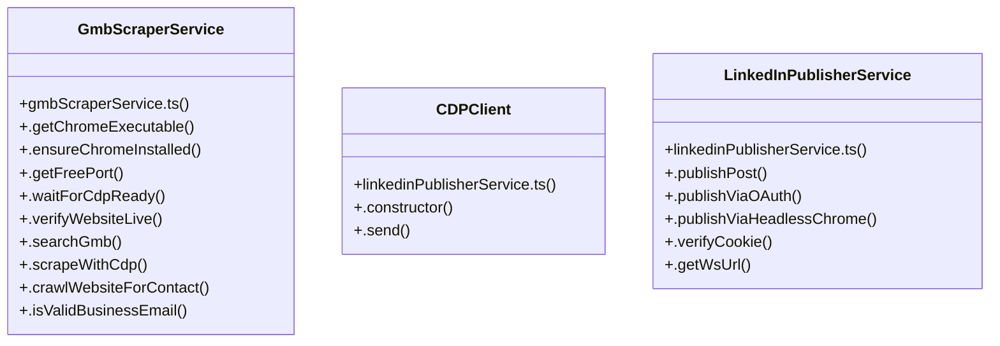

# [EmailValidatorService & AutomatedIntakeEngine] Cluster

> 24 nodes · cohesion 0.14

## Key Concepts

- [GmbScraperService](file:///Users/ujjawal/Documents/ChatBot/Outreach-Dashboard/server/src/services/gmbScraperService.ts#L75) (12 connections)
- [.importScrapedLeads()](file:///Users/ujjawal/Documents/ChatBot/Outreach-Dashboard/server/src/services/gmbScraperService.ts#L1183) (8 connections)
- [.scrapeWithCdp()](file:///Users/ujjawal/Documents/ChatBot/Outreach-Dashboard/server/src/services/gmbScraperService.ts#L647) (7 connections)
- [.getChromeExecutable()](file:///Users/ujjawal/Documents/ChatBot/Outreach-Dashboard/server/src/services/gmbScraperService.ts#L83) (6 connections)
- [LinkedInPublisherService](file:///Users/ujjawal/Documents/ChatBot/Outreach-Dashboard/server/src/services/linkedinPublisherService.ts#L16) (6 connections)
- [.searchGmb()](file:///Users/ujjawal/Documents/ChatBot/Outreach-Dashboard/server/src/services/gmbScraperService.ts#L414) (5 connections)
- [.publishPost()](file:///Users/ujjawal/Documents/ChatBot/Outreach-Dashboard/server/src/services/linkedinPublisherService.ts#L26) (5 connections)
- [.publishViaHeadlessChrome()](file:///Users/ujjawal/Documents/ChatBot/Outreach-Dashboard/server/src/services/linkedinPublisherService.ts#L145) (5 connections)
- [.verifyCookie()](file:///Users/ujjawal/Documents/ChatBot/Outreach-Dashboard/server/src/services/linkedinPublisherService.ts#L356) (5 connections)
- [.send()](file:///Users/ujjawal/Documents/ChatBot/Outreach-Dashboard/server/src/services/linkedinPublisherService.ts#L501) (4 connections)
- [.publishViaOAuth()](file:///Users/ujjawal/Documents/ChatBot/Outreach-Dashboard/server/src/services/linkedinPublisherService.ts#L86) (4 connections)
- [.cleanBizName()](file:///Users/ujjawal/Documents/ChatBot/Outreach-Dashboard/server/src/services/gmbScraperService.ts#L1171) (3 connections)
- [.crawlWebsiteForContact()](file:///Users/ujjawal/Documents/ChatBot/Outreach-Dashboard/server/src/services/gmbScraperService.ts#L1048) (3 connections)
- [.ensureChromeInstalled()](file:///Users/ujjawal/Documents/ChatBot/Outreach-Dashboard/server/src/services/gmbScraperService.ts#L193) (3 connections)
- [.isValidBusinessEmail()](file:///Users/ujjawal/Documents/ChatBot/Outreach-Dashboard/server/src/services/gmbScraperService.ts#L1130) (3 connections)
- [CDPClient](file:///Users/ujjawal/Documents/ChatBot/Outreach-Dashboard/server/src/services/linkedinPublisherService.ts#L483) (3 connections)
- [.getWsUrl()](file:///Users/ujjawal/Documents/ChatBot/Outreach-Dashboard/server/src/services/linkedinPublisherService.ts#L466) (3 connections)
- [.getFreePort()](file:///Users/ujjawal/Documents/ChatBot/Outreach-Dashboard/server/src/services/gmbScraperService.ts#L221) (2 connections)
- [.waitForCdpReady()](file:///Users/ujjawal/Documents/ChatBot/Outreach-Dashboard/server/src/services/gmbScraperService.ts#L238) (2 connections)
- [handleImportLeads()](file:///Users/ujjawal/Documents/ChatBot/Outreach-Dashboard/src/pages/LeadScraperPage.tsx#L621) (2 connections)
- [.verifySessionCookie()](file:///Users/ujjawal/Documents/ChatBot/Outreach-Dashboard/server/src/services/linkedinService.ts#L975) (2 connections)
- [linkedinPublisherService.ts](file:///Users/ujjawal/Documents/ChatBot/Outreach-Dashboard/server/src/services/linkedinPublisherService.ts#L1) (2 connections)
- [.constructor()](file:///Users/ujjawal/Documents/ChatBot/Outreach-Dashboard/server/src/services/linkedinPublisherService.ts#L487) (1 connections)
- [gmbScraperService.ts](file:///Users/ujjawal/Documents/ChatBot/Outreach-Dashboard/server/src/services/gmbScraperService.ts#L1) (1 connections)

## Class Diagram

## Relationships

- No strong cross-community connections detected

## Source Files

- [/Users/ujjawal/Documents/ChatBot/Outreach-Dashboard/server/src/services/gmbScraperService.ts](file:///Users/ujjawal/Documents/ChatBot/Outreach-Dashboard/server/src/services/gmbScraperService.ts)
- [/Users/ujjawal/Documents/ChatBot/Outreach-Dashboard/server/src/services/linkedinPublisherService.ts](file:///Users/ujjawal/Documents/ChatBot/Outreach-Dashboard/server/src/services/linkedinPublisherService.ts)
- [/Users/ujjawal/Documents/ChatBot/Outreach-Dashboard/server/src/services/linkedinService.ts](file:///Users/ujjawal/Documents/ChatBot/Outreach-Dashboard/server/src/services/linkedinService.ts)
- [/Users/ujjawal/Documents/ChatBot/Outreach-Dashboard/src/pages/LeadScraperPage.tsx](file:///Users/ujjawal/Documents/ChatBot/Outreach-Dashboard/src/pages/LeadScraperPage.tsx)

## Audit Trail

- EXTRACTED: 73 (75%)
- INFERRED: 24 (25%)
- AMBIGUOUS: 0 (0%)

---

*Part of the graphify knowledge wiki. See [[index]] to navigate.*