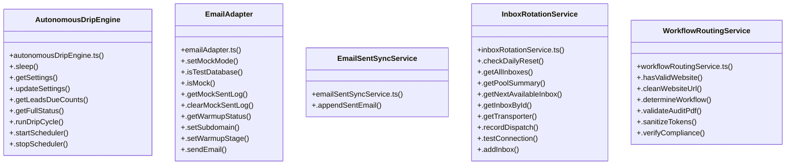

# [GoogleEnrichmentService & cleanSiteUrl()] Cluster

> 49 nodes · cohesion 0.06

## Key Concepts

- [.sendEmail()](file:///Users/ujjawal/Documents/ChatBot/Outreach-Dashboard/server/src/adapters/emailAdapter.ts#L224) (25 connections)
- [InboxRotationService](file:///Users/ujjawal/Documents/ChatBot/Outreach-Dashboard/server/src/services/inboxRotationService.ts#L39) (12 connections)
- [EmailAdapter](file:///Users/ujjawal/Documents/ChatBot/Outreach-Dashboard/server/src/adapters/emailAdapter.ts#L107) (10 connections)
- [AutonomousDripEngine](file:///Users/ujjawal/Documents/ChatBot/Outreach-Dashboard/server/src/services/autonomousDripEngine.ts#L47) (9 connections)
- [WorkflowRoutingService](file:///Users/ujjawal/Documents/ChatBot/Outreach-Dashboard/server/src/services/workflowRoutingService.ts#L19) (7 connections)
- [.hasValidWebsite()](file:///Users/ujjawal/Documents/ChatBot/Outreach-Dashboard/server/src/services/workflowRoutingService.ts#L23) (7 connections)
- [.getAllInboxes()](file:///Users/ujjawal/Documents/ChatBot/Outreach-Dashboard/server/src/services/inboxRotationService.ts#L63) (6 connections)
- [.getPoolSummary()](file:///Users/ujjawal/Documents/ChatBot/Outreach-Dashboard/server/src/services/inboxRotationService.ts#L106) (6 connections)
- [.runDripCycle()](file:///Users/ujjawal/Documents/ChatBot/Outreach-Dashboard/server/src/services/autonomousDripEngine.ts#L271) (5 connections)
- [.checkDailyReset()](file:///Users/ujjawal/Documents/ChatBot/Outreach-Dashboard/server/src/services/inboxRotationService.ts#L45) (5 connections)
- [.getFullStatus()](file:///Users/ujjawal/Documents/ChatBot/Outreach-Dashboard/server/src/services/autonomousDripEngine.ts#L204) (4 connections)
- [.getSettings()](file:///Users/ujjawal/Documents/ChatBot/Outreach-Dashboard/server/src/services/autonomousDripEngine.ts#L62) (4 connections)
- [buildHumanoidHtml()](file:///Users/ujjawal/Documents/ChatBot/Outreach-Dashboard/server/src/adapters/emailAdapter.ts#L56) (4 connections)
- [.appendSentEmail()](file:///Users/ujjawal/Documents/ChatBot/Outreach-Dashboard/server/src/services/emailSentSyncService.ts#L22) (4 connections)
- [.getNextAvailableInbox()](file:///Users/ujjawal/Documents/ChatBot/Outreach-Dashboard/server/src/services/inboxRotationService.ts#L148) (4 connections)
- [.getTransporter()](file:///Users/ujjawal/Documents/ChatBot/Outreach-Dashboard/server/src/services/inboxRotationService.ts#L183) (4 connections)
- [classifySmtpError()](file:///Users/ujjawal/Documents/ChatBot/Outreach-Dashboard/server/src/utils/smtpClassifier.ts#L28) (4 connections)
- [.updateSettings()](file:///Users/ujjawal/Documents/ChatBot/Outreach-Dashboard/server/src/services/autonomousDripEngine.ts#L98) (3 connections)
- [.isMock()](file:///Users/ujjawal/Documents/ChatBot/Outreach-Dashboard/server/src/adapters/emailAdapter.ts#L121) (3 connections)
- [.isTestDatabase()](file:///Users/ujjawal/Documents/ChatBot/Outreach-Dashboard/server/src/adapters/emailAdapter.ts#L116) (3 connections)
- [testHtmlEscaping()](file:///Users/ujjawal/Documents/ChatBot/Outreach-Dashboard/tests/htmlEscape.test.ts#L4) (3 connections)
- [.getInboxById()](file:///Users/ujjawal/Documents/ChatBot/Outreach-Dashboard/server/src/services/inboxRotationService.ts#L175) (3 connections)
- [.recordDispatch()](file:///Users/ujjawal/Documents/ChatBot/Outreach-Dashboard/server/src/services/inboxRotationService.ts#L237) (3 connections)
- [.testConnection()](file:///Users/ujjawal/Documents/ChatBot/Outreach-Dashboard/server/src/services/inboxRotationService.ts#L270) (3 connections)
- [emailAdapter.ts](file:///Users/ujjawal/Documents/ChatBot/Outreach-Dashboard/server/src/adapters/emailAdapter.ts#L1) (3 connections)
- *... and 24 more nodes in this community*

## Class Diagram

## Relationships

- No strong cross-community connections detected

## Source Files

- [/Users/ujjawal/Documents/ChatBot/Outreach-Dashboard/server/src/adapters/emailAdapter.ts](file:///Users/ujjawal/Documents/ChatBot/Outreach-Dashboard/server/src/adapters/emailAdapter.ts)
- [/Users/ujjawal/Documents/ChatBot/Outreach-Dashboard/server/src/services/autonomousDripEngine.ts](file:///Users/ujjawal/Documents/ChatBot/Outreach-Dashboard/server/src/services/autonomousDripEngine.ts)
- [/Users/ujjawal/Documents/ChatBot/Outreach-Dashboard/server/src/services/emailSentSyncService.ts](file:///Users/ujjawal/Documents/ChatBot/Outreach-Dashboard/server/src/services/emailSentSyncService.ts)
- [/Users/ujjawal/Documents/ChatBot/Outreach-Dashboard/server/src/services/inboxRotationService.ts](file:///Users/ujjawal/Documents/ChatBot/Outreach-Dashboard/server/src/services/inboxRotationService.ts)
- [/Users/ujjawal/Documents/ChatBot/Outreach-Dashboard/server/src/services/workflowRoutingService.ts](file:///Users/ujjawal/Documents/ChatBot/Outreach-Dashboard/server/src/services/workflowRoutingService.ts)
- [/Users/ujjawal/Documents/ChatBot/Outreach-Dashboard/server/src/utils/smtpClassifier.ts](file:///Users/ujjawal/Documents/ChatBot/Outreach-Dashboard/server/src/utils/smtpClassifier.ts)
- [/Users/ujjawal/Documents/ChatBot/Outreach-Dashboard/src/pages/CrmPage.tsx](file:///Users/ujjawal/Documents/ChatBot/Outreach-Dashboard/src/pages/CrmPage.tsx)
- [/Users/ujjawal/Documents/ChatBot/Outreach-Dashboard/tests/htmlEscape.test.ts](file:///Users/ujjawal/Documents/ChatBot/Outreach-Dashboard/tests/htmlEscape.test.ts)

## Audit Trail

- EXTRACTED: 122 (65%)
- INFERRED: 65 (35%)
- AMBIGUOUS: 0 (0%)

---

*Part of the graphify knowledge wiki. See [[index]] to navigate.*