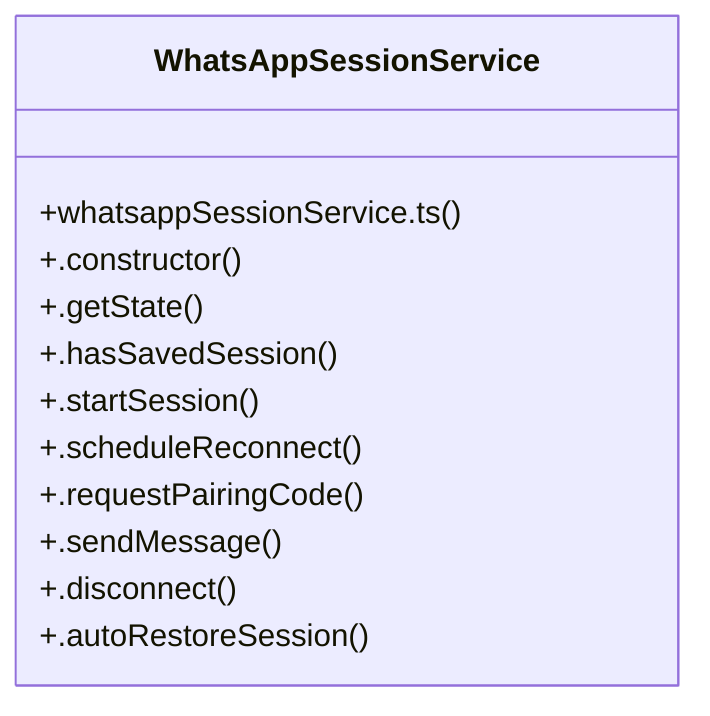

# [InboxRotationService & AutonomousDripEngine] Cluster

> 48 nodes · cohesion 0.05

## Key Concepts

- [index.ts](file:///Users/ujjawal/Documents/ChatBot/Outreach-Dashboard/server/src/index.ts#L1) (20 connections)
- [WhatsAppSessionService](file:///Users/ujjawal/Documents/ChatBot/Outreach-Dashboard/server/src/services/whatsappSessionService.ts#L27) (11 connections)
- [startServer()](file:///Users/ujjawal/Documents/ChatBot/Outreach-Dashboard/server/src/index.ts#L372) (10 connections)
- [whatsappPostgresAuth.ts](file:///Users/ujjawal/Documents/ChatBot/Outreach-Dashboard/server/src/services/whatsappPostgresAuth.ts#L1) (5 connections)
- [usePostgresAuthState()](file:///Users/ujjawal/Documents/ChatBot/Outreach-Dashboard/server/src/services/whatsappPostgresAuth.ts#L53) (5 connections)
- [.startSession()](file:///Users/ujjawal/Documents/ChatBot/Outreach-Dashboard/server/src/services/whatsappSessionService.ts#L78) (5 connections)
- [devMockDaemons.ts](file:///Users/ujjawal/Documents/ChatBot/Outreach-Dashboard/server/src/services/devMockDaemons.ts#L1) (4 connections)
- [.autoRestoreSession()](file:///Users/ujjawal/Documents/ChatBot/Outreach-Dashboard/server/src/services/whatsappSessionService.ts#L384) (4 connections)
- [.getState()](file:///Users/ujjawal/Documents/ChatBot/Outreach-Dashboard/server/src/services/whatsappSessionService.ts#L54) (4 connections)
- [run28DayRetentionCleanup()](file:///Users/ujjawal/Documents/ChatBot/Outreach-Dashboard/server/src/index.ts#L291) (3 connections)
- [runMigrations()](file:///Users/ujjawal/Documents/ChatBot/Outreach-Dashboard/server/src/db/migrate.ts#L10) (3 connections)
- [migrate.ts](file:///Users/ujjawal/Documents/ChatBot/Outreach-Dashboard/server/src/db/migrate.ts#L1) (3 connections)
- [encryptSessionData()](file:///Users/ujjawal/Documents/ChatBot/Outreach-Dashboard/server/src/services/whatsappPostgresAuth.ts#L21) (3 connections)
- [getSessionEncryptionKey()](file:///Users/ujjawal/Documents/ChatBot/Outreach-Dashboard/server/src/services/whatsappPostgresAuth.ts#L16) (3 connections)
- [startDevMockDaemons()](file:///Users/ujjawal/Documents/ChatBot/Outreach-Dashboard/server/src/services/devMockDaemons.ts#L14) (2 connections)
- [.startPolling()](file:///Users/ujjawal/Documents/ChatBot/Outreach-Dashboard/server/src/services/emailInboundService.ts#L1111) (2 connections)
- [run10MinAuditPdfCleanup()](file:///Users/ujjawal/Documents/ChatBot/Outreach-Dashboard/server/src/index.ts#L318) (2 connections)
- [decryptSessionData()](file:///Users/ujjawal/Documents/ChatBot/Outreach-Dashboard/server/src/services/whatsappPostgresAuth.ts#L30) (2 connections)
- [fixKeyName()](file:///Users/ujjawal/Documents/ChatBot/Outreach-Dashboard/server/src/services/whatsappPostgresAuth.ts#L14) (2 connections)
- [.cleanupSession()](file:///Users/ujjawal/Documents/ChatBot/Outreach-Dashboard/server/src/services/whatsappSessionService.ts#L396) (2 connections)
- [.disconnect()](file:///Users/ujjawal/Documents/ChatBot/Outreach-Dashboard/server/src/services/whatsappSessionService.ts#L346) (2 connections)
- [.hasSavedSession()](file:///Users/ujjawal/Documents/ChatBot/Outreach-Dashboard/server/src/services/whatsappSessionService.ts#L61) (2 connections)
- [.requestPairingCode()](file:///Users/ujjawal/Documents/ChatBot/Outreach-Dashboard/server/src/services/whatsappSessionService.ts#L252) (2 connections)
- [ollamaServer](file:///Users/ujjawal/Documents/ChatBot/Outreach-Dashboard/server/src/services/devMockDaemons.ts#L12) (1 connections)
- [stopDevMockDaemons()](file:///Users/ujjawal/Documents/ChatBot/Outreach-Dashboard/server/src/services/devMockDaemons.ts#L275) (1 connections)
- *... and 23 more nodes in this community*

## Class Diagram

## Relationships

- No strong cross-community connections detected

## Source Files

- [/Users/ujjawal/Documents/ChatBot/Outreach-Dashboard/server/src/db/migrate.ts](file:///Users/ujjawal/Documents/ChatBot/Outreach-Dashboard/server/src/db/migrate.ts)
- [/Users/ujjawal/Documents/ChatBot/Outreach-Dashboard/server/src/index.ts](file:///Users/ujjawal/Documents/ChatBot/Outreach-Dashboard/server/src/index.ts)
- [/Users/ujjawal/Documents/ChatBot/Outreach-Dashboard/server/src/services/devMockDaemons.ts](file:///Users/ujjawal/Documents/ChatBot/Outreach-Dashboard/server/src/services/devMockDaemons.ts)
- [/Users/ujjawal/Documents/ChatBot/Outreach-Dashboard/server/src/services/emailInboundService.ts](file:///Users/ujjawal/Documents/ChatBot/Outreach-Dashboard/server/src/services/emailInboundService.ts)
- [/Users/ujjawal/Documents/ChatBot/Outreach-Dashboard/server/src/services/whatsappPostgresAuth.ts](file:///Users/ujjawal/Documents/ChatBot/Outreach-Dashboard/server/src/services/whatsappPostgresAuth.ts)
- [/Users/ujjawal/Documents/ChatBot/Outreach-Dashboard/server/src/services/whatsappSessionService.ts](file:///Users/ujjawal/Documents/ChatBot/Outreach-Dashboard/server/src/services/whatsappSessionService.ts)

## Audit Trail

- EXTRACTED: 108 (86%)
- INFERRED: 18 (14%)
- AMBIGUOUS: 0 (0%)

---

*Part of the graphify knowledge wiki. See [[index]] to navigate.*