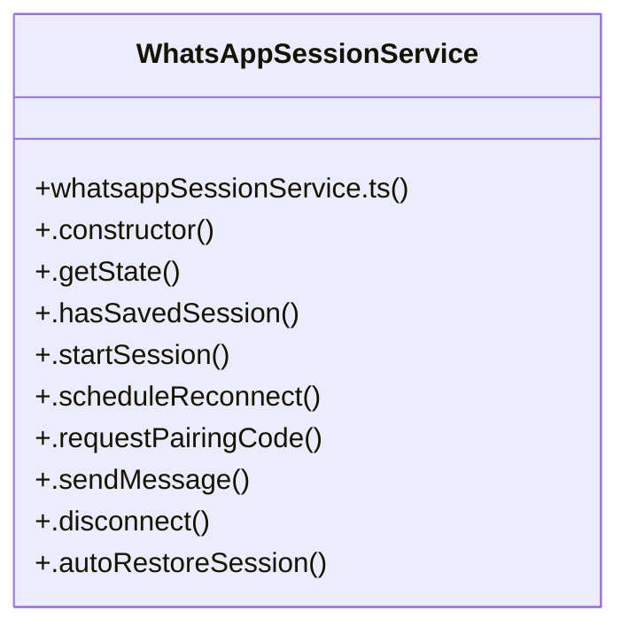

# [WhatsAppSessionService & startServer()] Cluster

> 39 nodes · cohesion 0.07

## Key Concepts

- [index.ts](file:///Users/ujjawal/Documents/ChatBot/Outreach-Dashboard/server/src/index.ts#L1) (16 connections)
- [WhatsAppSessionService](file:///Users/ujjawal/Documents/ChatBot/Outreach-Dashboard/server/src/services/whatsappSessionService.ts#L27) (11 connections)
- [startServer()](file:///Users/ujjawal/Documents/ChatBot/Outreach-Dashboard/server/src/index.ts#L340) (9 connections)
- [whatsappPostgresAuth.ts](file:///Users/ujjawal/Documents/ChatBot/Outreach-Dashboard/server/src/services/whatsappPostgresAuth.ts#L1) (5 connections)
- [usePostgresAuthState()](file:///Users/ujjawal/Documents/ChatBot/Outreach-Dashboard/server/src/services/whatsappPostgresAuth.ts#L53) (5 connections)
- [.startSession()](file:///Users/ujjawal/Documents/ChatBot/Outreach-Dashboard/server/src/services/whatsappSessionService.ts#L78) (5 connections)
- [.autoRestoreSession()](file:///Users/ujjawal/Documents/ChatBot/Outreach-Dashboard/server/src/services/whatsappSessionService.ts#L370) (4 connections)
- [.getState()](file:///Users/ujjawal/Documents/ChatBot/Outreach-Dashboard/server/src/services/whatsappSessionService.ts#L54) (4 connections)
- [run28DayRetentionCleanup()](file:///Users/ujjawal/Documents/ChatBot/Outreach-Dashboard/server/src/index.ts#L259) (3 connections)
- [runMigrations()](file:///Users/ujjawal/Documents/ChatBot/Outreach-Dashboard/server/src/db/migrate.ts#L10) (3 connections)
- [migrate.ts](file:///Users/ujjawal/Documents/ChatBot/Outreach-Dashboard/server/src/db/migrate.ts#L1) (3 connections)
- [encryptSessionData()](file:///Users/ujjawal/Documents/ChatBot/Outreach-Dashboard/server/src/services/whatsappPostgresAuth.ts#L21) (3 connections)
- [getSessionEncryptionKey()](file:///Users/ujjawal/Documents/ChatBot/Outreach-Dashboard/server/src/services/whatsappPostgresAuth.ts#L16) (3 connections)
- [.startPolling()](file:///Users/ujjawal/Documents/ChatBot/Outreach-Dashboard/server/src/services/emailInboundService.ts#L886) (2 connections)
- [run30MinAuditPdfCleanup()](file:///Users/ujjawal/Documents/ChatBot/Outreach-Dashboard/server/src/index.ts#L286) (2 connections)
- [decryptSessionData()](file:///Users/ujjawal/Documents/ChatBot/Outreach-Dashboard/server/src/services/whatsappPostgresAuth.ts#L30) (2 connections)
- [fixKeyName()](file:///Users/ujjawal/Documents/ChatBot/Outreach-Dashboard/server/src/services/whatsappPostgresAuth.ts#L14) (2 connections)
- [.cleanupSession()](file:///Users/ujjawal/Documents/ChatBot/Outreach-Dashboard/server/src/services/whatsappSessionService.ts#L382) (2 connections)
- [.disconnect()](file:///Users/ujjawal/Documents/ChatBot/Outreach-Dashboard/server/src/services/whatsappSessionService.ts#L332) (2 connections)
- [.hasSavedSession()](file:///Users/ujjawal/Documents/ChatBot/Outreach-Dashboard/server/src/services/whatsappSessionService.ts#L61) (2 connections)
- [.requestPairingCode()](file:///Users/ujjawal/Documents/ChatBot/Outreach-Dashboard/server/src/services/whatsappSessionService.ts#L241) (2 connections)
- [allowedOrigins](file:///Users/ujjawal/Documents/ChatBot/Outreach-Dashboard/server/src/index.ts#L132) (1 connections)
- [app](file:///Users/ujjawal/Documents/ChatBot/Outreach-Dashboard/server/src/index.ts#L64) (1 connections)
- [decoded](file:///Users/ujjawal/Documents/ChatBot/Outreach-Dashboard/server/src/index.ts#L79) (1 connections)
- [distPath](file:///Users/ujjawal/Documents/ChatBot/Outreach-Dashboard/server/src/index.ts#L316) (1 connections)
- *... and 14 more nodes in this community*

## Class Diagram

## Relationships

- No strong cross-community connections detected

## Source Files

- [/Users/ujjawal/Documents/ChatBot/Outreach-Dashboard/server/src/db/migrate.ts](file:///Users/ujjawal/Documents/ChatBot/Outreach-Dashboard/server/src/db/migrate.ts)
- [/Users/ujjawal/Documents/ChatBot/Outreach-Dashboard/server/src/index.ts](file:///Users/ujjawal/Documents/ChatBot/Outreach-Dashboard/server/src/index.ts)
- [/Users/ujjawal/Documents/ChatBot/Outreach-Dashboard/server/src/services/emailInboundService.ts](file:///Users/ujjawal/Documents/ChatBot/Outreach-Dashboard/server/src/services/emailInboundService.ts)
- [/Users/ujjawal/Documents/ChatBot/Outreach-Dashboard/server/src/services/whatsappPostgresAuth.ts](file:///Users/ujjawal/Documents/ChatBot/Outreach-Dashboard/server/src/services/whatsappPostgresAuth.ts)
- [/Users/ujjawal/Documents/ChatBot/Outreach-Dashboard/server/src/services/whatsappSessionService.ts](file:///Users/ujjawal/Documents/ChatBot/Outreach-Dashboard/server/src/services/whatsappSessionService.ts)

## Audit Trail

- EXTRACTED: 92 (85%)
- INFERRED: 16 (15%)
- AMBIGUOUS: 0 (0%)

---

*Part of the graphify knowledge wiki. See [[index]] to navigate.*