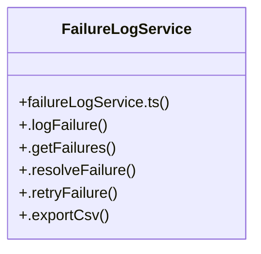

# [[activeTab, setActiveTab] & [batchName, setBatchName]] Cluster

> 29 nodes · cohesion 0.08

## Key Concepts

- [FailuresPage.tsx](file:///Users/ujjawal/Documents/ChatBot/Outreach-Dashboard/src/pages/FailuresPage.tsx#L1) (22 connections)
- [FailureLogService](file:///Users/ujjawal/Documents/ChatBot/Outreach-Dashboard/server/src/services/failureLogService.ts#L36) (6 connections)
- [.retryFailure()](file:///Users/ujjawal/Documents/ChatBot/Outreach-Dashboard/server/src/services/failureLogService.ts#L179) (4 connections)
- [.exportCsv()](file:///Users/ujjawal/Documents/ChatBot/Outreach-Dashboard/server/src/services/failureLogService.ts#L231) (3 connections)
- [.resolveFailure()](file:///Users/ujjawal/Documents/ChatBot/Outreach-Dashboard/server/src/services/failureLogService.ts#L168) (3 connections)
- [fetchFailures](file:///Users/ujjawal/Documents/ChatBot/Outreach-Dashboard/src/pages/FailuresPage.tsx#L38) (3 connections)
- [handleResolve()](file:///Users/ujjawal/Documents/ChatBot/Outreach-Dashboard/src/pages/FailuresPage.tsx#L68) (3 connections)
- [handleRetry()](file:///Users/ujjawal/Documents/ChatBot/Outreach-Dashboard/src/pages/FailuresPage.tsx#L88) (3 connections)
- [.getFailures()](file:///Users/ujjawal/Documents/ChatBot/Outreach-Dashboard/server/src/services/failureLogService.ts#L79) (2 connections)
- [[actionInProgress, setActionInProgress]](file:///Users/ujjawal/Documents/ChatBot/Outreach-Dashboard/src/pages/FailuresPage.tsx#L35) (1 connections)
- [[endDate, setEndDate]](file:///Users/ujjawal/Documents/ChatBot/Outreach-Dashboard/src/pages/FailuresPage.tsx#L34) (1 connections)
- [[feedback, setFeedback]](file:///Users/ujjawal/Documents/ChatBot/Outreach-Dashboard/src/pages/FailuresPage.tsx#L36) (1 connections)
- [handleExportCsv()](file:///Users/ujjawal/Documents/ChatBot/Outreach-Dashboard/src/pages/FailuresPage.tsx#L108) (1 connections)
- [isResolving](file:///Users/ujjawal/Documents/ChatBot/Outreach-Dashboard/src/pages/FailuresPage.tsx#L352) (1 connections)
- [isRetrying](file:///Users/ujjawal/Documents/ChatBot/Outreach-Dashboard/src/pages/FailuresPage.tsx#L353) (1 connections)
- [[loading, setLoading]](file:///Users/ujjawal/Documents/ChatBot/Outreach-Dashboard/src/pages/FailuresPage.tsx#L28) (1 connections)
- [[records, setRecords]](file:///Users/ujjawal/Documents/ChatBot/Outreach-Dashboard/src/pages/FailuresPage.tsx#L21) (1 connections)
- [[resolvedFilter, setResolvedFilter]](file:///Users/ujjawal/Documents/ChatBot/Outreach-Dashboard/src/pages/FailuresPage.tsx#L32) (1 connections)
- [[search, setSearch]](file:///Users/ujjawal/Documents/ChatBot/Outreach-Dashboard/src/pages/FailuresPage.tsx#L29) (1 connections)
- [[selectedSlot, setSelectedSlot]](file:///Users/ujjawal/Documents/ChatBot/Outreach-Dashboard/src/pages/FailuresPage.tsx#L31) (1 connections)
- [[selectedType, setSelectedType]](file:///Users/ujjawal/Documents/ChatBot/Outreach-Dashboard/src/pages/FailuresPage.tsx#L30) (1 connections)
- [slotClass](file:///Users/ujjawal/Documents/ChatBot/Outreach-Dashboard/src/pages/FailuresPage.tsx#L351) (1 connections)
- [slotPills](file:///Users/ujjawal/Documents/ChatBot/Outreach-Dashboard/src/pages/FailuresPage.tsx#L128) (1 connections)
- [[startDate, setStartDate]](file:///Users/ujjawal/Documents/ChatBot/Outreach-Dashboard/src/pages/FailuresPage.tsx#L33) (1 connections)
- [[stats, setStats]](file:///Users/ujjawal/Documents/ChatBot/Outreach-Dashboard/src/pages/FailuresPage.tsx#L23) (1 connections)
- *... and 4 more nodes in this community*

## Class Diagram

## Relationships

- No strong cross-community connections detected

## Source Files

- [/Users/ujjawal/Documents/ChatBot/Outreach-Dashboard/server/src/services/failureLogService.ts](file:///Users/ujjawal/Documents/ChatBot/Outreach-Dashboard/server/src/services/failureLogService.ts)
- [/Users/ujjawal/Documents/ChatBot/Outreach-Dashboard/src/pages/FailuresPage.tsx](file:///Users/ujjawal/Documents/ChatBot/Outreach-Dashboard/src/pages/FailuresPage.tsx)

## Audit Trail

- EXTRACTED: 61 (88%)
- INFERRED: 8 (12%)
- AMBIGUOUS: 0 (0%)

---

*Part of the graphify knowledge wiki. See [[index]] to navigate.*