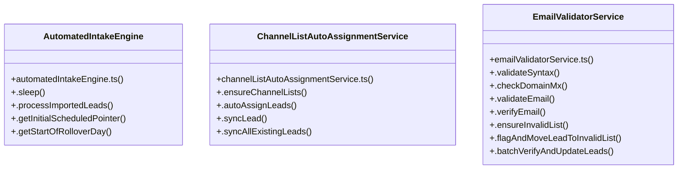

# [[autoOpenContact, setAutoOpenContact] & channelCounts] Cluster

> 24 nodes · cohesion 0.14

## Key Concepts

- [.processImportedLeads()](file:///Users/ujjawal/Documents/ChatBot/Outreach-Dashboard/server/src/services/automatedIntakeEngine.ts#L34) (11 connections)
- [.autoAssignLeads()](file:///Users/ujjawal/Documents/ChatBot/Outreach-Dashboard/server/src/services/channelListAutoAssignmentService.ts#L106) (8 connections)
- [EmailValidatorService](file:///Users/ujjawal/Documents/ChatBot/Outreach-Dashboard/server/src/services/emailValidatorService.ts#L65) (8 connections)
- [.verifyEmail()](file:///Users/ujjawal/Documents/ChatBot/Outreach-Dashboard/server/src/services/emailValidatorService.ts#L187) (8 connections)
- [.flagAndMoveLeadToInvalidList()](file:///Users/ujjawal/Documents/ChatBot/Outreach-Dashboard/server/src/services/emailValidatorService.ts#L331) (6 connections)
- [AutomatedIntakeEngine](file:///Users/ujjawal/Documents/ChatBot/Outreach-Dashboard/server/src/services/automatedIntakeEngine.ts#L18) (5 connections)
- [ChannelListAutoAssignmentService](file:///Users/ujjawal/Documents/ChatBot/Outreach-Dashboard/server/src/services/channelListAutoAssignmentService.ts#L14) (5 connections)
- [.batchVerifyAndUpdateLeads()](file:///Users/ujjawal/Documents/ChatBot/Outreach-Dashboard/server/src/services/emailValidatorService.ts#L408) (5 connections)
- [.ensureChannelLists()](file:///Users/ujjawal/Documents/ChatBot/Outreach-Dashboard/server/src/services/channelListAutoAssignmentService.ts#L21) (4 connections)
- [.validateSyntax()](file:///Users/ujjawal/Documents/ChatBot/Outreach-Dashboard/server/src/services/emailValidatorService.ts#L73) (4 connections)
- [emailValidatorService.ts](file:///Users/ujjawal/Documents/ChatBot/Outreach-Dashboard/server/src/services/emailValidatorService.ts#L1) (4 connections)
- [.getInitialScheduledPointer()](file:///Users/ujjawal/Documents/ChatBot/Outreach-Dashboard/server/src/services/automatedIntakeEngine.ts#L298) (3 connections)
- [.getStartOfRolloverDay()](file:///Users/ujjawal/Documents/ChatBot/Outreach-Dashboard/server/src/services/automatedIntakeEngine.ts#L329) (3 connections)
- [.checkDomainMx()](file:///Users/ujjawal/Documents/ChatBot/Outreach-Dashboard/server/src/services/emailValidatorService.ts#L130) (3 connections)
- [.syncAllExistingLeads()](file:///Users/ujjawal/Documents/ChatBot/Outreach-Dashboard/server/src/services/channelListAutoAssignmentService.ts#L284) (2 connections)
- [.syncLead()](file:///Users/ujjawal/Documents/ChatBot/Outreach-Dashboard/server/src/services/channelListAutoAssignmentService.ts#L262) (2 connections)
- [.ensureInvalidList()](file:///Users/ujjawal/Documents/ChatBot/Outreach-Dashboard/server/src/services/emailValidatorService.ts#L294) (2 connections)
- [.validateEmail()](file:///Users/ujjawal/Documents/ChatBot/Outreach-Dashboard/server/src/services/emailValidatorService.ts#L180) (2 connections)
- [.sleep()](file:///Users/ujjawal/Documents/ChatBot/Outreach-Dashboard/server/src/services/automatedIntakeEngine.ts#L24) (1 connections)
- [KNOWN_INVALID_USERNAMES](file:///Users/ujjawal/Documents/ChatBot/Outreach-Dashboard/server/src/services/emailValidatorService.ts#L48) (1 connections)
- [KNOWN_PLACEHOLDER_DOMAINS](file:///Users/ujjawal/Documents/ChatBot/Outreach-Dashboard/server/src/services/emailValidatorService.ts#L16) (1 connections)
- [RFC_EMAIL_REGEX](file:///Users/ujjawal/Documents/ChatBot/Outreach-Dashboard/server/src/services/emailValidatorService.ts#L13) (1 connections)
- [automatedIntakeEngine.ts](file:///Users/ujjawal/Documents/ChatBot/Outreach-Dashboard/server/src/services/automatedIntakeEngine.ts#L1) (1 connections)
- [channelListAutoAssignmentService.ts](file:///Users/ujjawal/Documents/ChatBot/Outreach-Dashboard/server/src/services/channelListAutoAssignmentService.ts#L1) (1 connections)

## Class Diagram

## Relationships

- No strong cross-community connections detected

## Source Files

- [/Users/ujjawal/Documents/ChatBot/Outreach-Dashboard/server/src/services/automatedIntakeEngine.ts](file:///Users/ujjawal/Documents/ChatBot/Outreach-Dashboard/server/src/services/automatedIntakeEngine.ts)
- [/Users/ujjawal/Documents/ChatBot/Outreach-Dashboard/server/src/services/channelListAutoAssignmentService.ts](file:///Users/ujjawal/Documents/ChatBot/Outreach-Dashboard/server/src/services/channelListAutoAssignmentService.ts)
- [/Users/ujjawal/Documents/ChatBot/Outreach-Dashboard/server/src/services/emailValidatorService.ts](file:///Users/ujjawal/Documents/ChatBot/Outreach-Dashboard/server/src/services/emailValidatorService.ts)

## Audit Trail

- EXTRACTED: 66 (73%)
- INFERRED: 25 (27%)
- AMBIGUOUS: 0 (0%)

---

*Part of the graphify knowledge wiki. See [[index]] to navigate.*