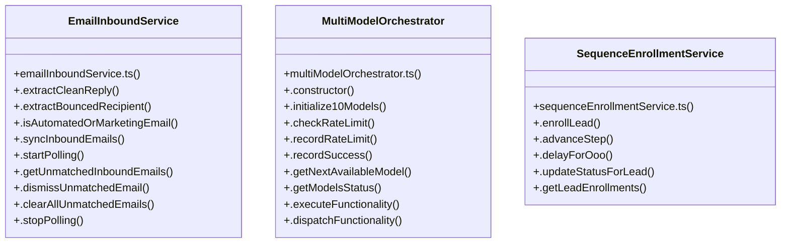

# [active & [activeTab, setActiveTab]] Cluster

> 60 nodes · cohesion 0.05

## Key Concepts

- [.get()](file:///Users/ujjawal/Documents/ChatBot/Outreach-Dashboard/server/src/config/cache.ts#L43) (35 connections)
- [keep-alive.js](file:///Users/ujjawal/Documents/ChatBot/Outreach-Dashboard/scripts/keep-alive.js#L1) (15 connections)
- [.syncInboundEmails()](file:///Users/ujjawal/Documents/ChatBot/Outreach-Dashboard/server/src/services/emailInboundService.ts#L260) (12 connections)
- [MultiModelOrchestrator](file:///Users/ujjawal/Documents/ChatBot/Outreach-Dashboard/server/src/services/multiModelOrchestrator.ts#L62) (11 connections)
- [EmailInboundService](file:///Users/ujjawal/Documents/ChatBot/Outreach-Dashboard/server/src/services/emailInboundService.ts#L24) (10 connections)
- [.executeFunctionality()](file:///Users/ujjawal/Documents/ChatBot/Outreach-Dashboard/server/src/services/multiModelOrchestrator.ts#L357) (10 connections)
- [store.ts](file:///Users/ujjawal/Documents/ChatBot/Outreach-Dashboard/src/store.ts#L1) (7 connections)
- [SequenceEnrollmentService](file:///Users/ujjawal/Documents/ChatBot/Outreach-Dashboard/server/src/services/sequenceEnrollmentService.ts#L17) (6 connections)
- [.extractBouncedRecipient()](file:///Users/ujjawal/Documents/ChatBot/Outreach-Dashboard/server/src/services/emailInboundService.ts#L77) (4 connections)
- [.isAutomatedOrMarketingEmail()](file:///Users/ujjawal/Documents/ChatBot/Outreach-Dashboard/server/src/services/emailInboundService.ts#L147) (4 connections)
- [.checkRateLimit()](file:///Users/ujjawal/Documents/ChatBot/Outreach-Dashboard/server/src/services/multiModelOrchestrator.ts#L204) (4 connections)
- [.getNextAvailableModel()](file:///Users/ujjawal/Documents/ChatBot/Outreach-Dashboard/server/src/services/multiModelOrchestrator.ts#L314) (4 connections)
- [.clearAllUnmatchedEmails()](file:///Users/ujjawal/Documents/ChatBot/Outreach-Dashboard/server/src/services/emailInboundService.ts#L1185) (3 connections)
- [.dismissUnmatchedEmail()](file:///Users/ujjawal/Documents/ChatBot/Outreach-Dashboard/server/src/services/emailInboundService.ts#L1177) (3 connections)
- [.extractCleanReply()](file:///Users/ujjawal/Documents/ChatBot/Outreach-Dashboard/server/src/services/emailInboundService.ts#L48) (3 connections)
- [testEtagPerformance()](file:///Users/ujjawal/Documents/ChatBot/Outreach-Dashboard/tests/etagConditional.test.ts#L3) (3 connections)
- [sendPing()](file:///Users/ujjawal/Documents/ChatBot/Outreach-Dashboard/scripts/keep-alive.js#L47) (3 connections)
- [.dispatchFunctionality()](file:///Users/ujjawal/Documents/ChatBot/Outreach-Dashboard/server/src/services/multiModelOrchestrator.ts#L421) (3 connections)
- [.getModelsStatus()](file:///Users/ujjawal/Documents/ChatBot/Outreach-Dashboard/server/src/services/multiModelOrchestrator.ts#L342) (3 connections)
- [.initialize10Models()](file:///Users/ujjawal/Documents/ChatBot/Outreach-Dashboard/server/src/services/multiModelOrchestrator.ts#L79) (3 connections)
- [.recordRateLimit()](file:///Users/ujjawal/Documents/ChatBot/Outreach-Dashboard/server/src/services/multiModelOrchestrator.ts#L273) (3 connections)
- [.recordSuccess()](file:///Users/ujjawal/Documents/ChatBot/Outreach-Dashboard/server/src/services/multiModelOrchestrator.ts#L291) (3 connections)
- [.runAllFunctionalityChecks()](file:///Users/ujjawal/Documents/ChatBot/Outreach-Dashboard/server/src/services/multiModelOrchestrator.ts#L567) (3 connections)
- [.delayForOoo()](file:///Users/ujjawal/Documents/ChatBot/Outreach-Dashboard/server/src/services/sequenceEnrollmentService.ts#L116) (3 connections)
- [.updateStatusForLead()](file:///Users/ujjawal/Documents/ChatBot/Outreach-Dashboard/server/src/services/sequenceEnrollmentService.ts#L137) (3 connections)
- *... and 35 more nodes in this community*

## Class Diagram

## Relationships

- No strong cross-community connections detected

## Source Files

- [/Users/ujjawal/Documents/ChatBot/Outreach-Dashboard/scripts/keep-alive.js](file:///Users/ujjawal/Documents/ChatBot/Outreach-Dashboard/scripts/keep-alive.js)
- [/Users/ujjawal/Documents/ChatBot/Outreach-Dashboard/server/src/config/cache.ts](file:///Users/ujjawal/Documents/ChatBot/Outreach-Dashboard/server/src/config/cache.ts)
- [/Users/ujjawal/Documents/ChatBot/Outreach-Dashboard/server/src/services/emailInboundService.ts](file:///Users/ujjawal/Documents/ChatBot/Outreach-Dashboard/server/src/services/emailInboundService.ts)
- [/Users/ujjawal/Documents/ChatBot/Outreach-Dashboard/server/src/services/fiveSlotSenderService.ts](file:///Users/ujjawal/Documents/ChatBot/Outreach-Dashboard/server/src/services/fiveSlotSenderService.ts)
- [/Users/ujjawal/Documents/ChatBot/Outreach-Dashboard/server/src/services/multiModelOrchestrator.ts](file:///Users/ujjawal/Documents/ChatBot/Outreach-Dashboard/server/src/services/multiModelOrchestrator.ts)
- [/Users/ujjawal/Documents/ChatBot/Outreach-Dashboard/server/src/services/sequenceEnrollmentService.ts](file:///Users/ujjawal/Documents/ChatBot/Outreach-Dashboard/server/src/services/sequenceEnrollmentService.ts)
- [/Users/ujjawal/Documents/ChatBot/Outreach-Dashboard/src/components/InboundRepliesModal.tsx](file:///Users/ujjawal/Documents/ChatBot/Outreach-Dashboard/src/components/InboundRepliesModal.tsx)
- [/Users/ujjawal/Documents/ChatBot/Outreach-Dashboard/src/store.ts](file:///Users/ujjawal/Documents/ChatBot/Outreach-Dashboard/src/store.ts)
- [/Users/ujjawal/Documents/ChatBot/Outreach-Dashboard/tests/cors-csrf.test.ts](file:///Users/ujjawal/Documents/ChatBot/Outreach-Dashboard/tests/cors-csrf.test.ts)
- [/Users/ujjawal/Documents/ChatBot/Outreach-Dashboard/tests/etagConditional.test.ts](file:///Users/ujjawal/Documents/ChatBot/Outreach-Dashboard/tests/etagConditional.test.ts)

## Audit Trail

- EXTRACTED: 134 (64%)
- INFERRED: 76 (36%)
- AMBIGUOUS: 0 (0%)

---

*Part of the graphify knowledge wiki. See [[index]] to navigate.*