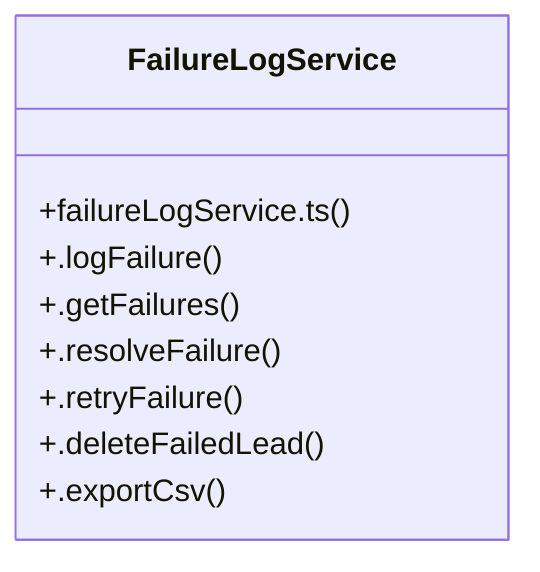

# [active & activeChannelMeta] Cluster

> 35 nodes · cohesion 0.07

## Key Concepts

- [FailuresPage.tsx](file:///Users/ujjawal/Documents/ChatBot/Outreach-Dashboard/src/pages/FailuresPage.tsx#L1) (27 connections)
- [FailureLogService](file:///Users/ujjawal/Documents/ChatBot/Outreach-Dashboard/server/src/services/failureLogService.ts#L38) (7 connections)
- [.retryFailure()](file:///Users/ujjawal/Documents/ChatBot/Outreach-Dashboard/server/src/services/failureLogService.ts#L224) (5 connections)
- [fetchFailures](file:///Users/ujjawal/Documents/ChatBot/Outreach-Dashboard/src/pages/FailuresPage.tsx#L48) (4 connections)
- [.deleteFailedLead()](file:///Users/ujjawal/Documents/ChatBot/Outreach-Dashboard/server/src/services/failureLogService.ts#L306) (3 connections)
- [.exportCsv()](file:///Users/ujjawal/Documents/ChatBot/Outreach-Dashboard/server/src/services/failureLogService.ts#L382) (3 connections)
- [.resolveFailure()](file:///Users/ujjawal/Documents/ChatBot/Outreach-Dashboard/server/src/services/failureLogService.ts#L213) (3 connections)
- [handleConfirmDeleteLead()](file:///Users/ujjawal/Documents/ChatBot/Outreach-Dashboard/src/pages/FailuresPage.tsx#L120) (3 connections)
- [handleResolve()](file:///Users/ujjawal/Documents/ChatBot/Outreach-Dashboard/src/pages/FailuresPage.tsx#L78) (3 connections)
- [handleRetry()](file:///Users/ujjawal/Documents/ChatBot/Outreach-Dashboard/src/pages/FailuresPage.tsx#L98) (3 connections)
- [.getFailures()](file:///Users/ujjawal/Documents/ChatBot/Outreach-Dashboard/server/src/services/failureLogService.ts#L121) (2 connections)
- [handleExportCsv()](file:///Users/ujjawal/Documents/ChatBot/Outreach-Dashboard/src/pages/FailuresPage.tsx#L145) (2 connections)
- [[actionInProgress, setActionInProgress]](file:///Users/ujjawal/Documents/ChatBot/Outreach-Dashboard/src/pages/FailuresPage.tsx#L44) (1 connections)
- [[debouncedSearch, setDebouncedSearch]](file:///Users/ujjawal/Documents/ChatBot/Outreach-Dashboard/src/pages/FailuresPage.tsx#L31) (1 connections)
- [[deleteConfirmRecord, setDeleteConfirmRecord]](file:///Users/ujjawal/Documents/ChatBot/Outreach-Dashboard/src/pages/FailuresPage.tsx#L45) (1 connections)
- [[endDate, setEndDate]](file:///Users/ujjawal/Documents/ChatBot/Outreach-Dashboard/src/pages/FailuresPage.tsx#L43) (1 connections)
- [[feedback, setFeedback]](file:///Users/ujjawal/Documents/ChatBot/Outreach-Dashboard/src/pages/FailuresPage.tsx#L46) (1 connections)
- [isDeleting](file:///Users/ujjawal/Documents/ChatBot/Outreach-Dashboard/src/pages/FailuresPage.tsx#L411) (1 connections)
- [isResolving](file:///Users/ujjawal/Documents/ChatBot/Outreach-Dashboard/src/pages/FailuresPage.tsx#L409) (1 connections)
- [isRetrying](file:///Users/ujjawal/Documents/ChatBot/Outreach-Dashboard/src/pages/FailuresPage.tsx#L410) (1 connections)
- [[loading, setLoading]](file:///Users/ujjawal/Documents/ChatBot/Outreach-Dashboard/src/pages/FailuresPage.tsx#L29) (1 connections)
- [[records, setRecords]](file:///Users/ujjawal/Documents/ChatBot/Outreach-Dashboard/src/pages/FailuresPage.tsx#L22) (1 connections)
- [[resolvedFilter, setResolvedFilter]](file:///Users/ujjawal/Documents/ChatBot/Outreach-Dashboard/src/pages/FailuresPage.tsx#L41) (1 connections)
- [[search, setSearch]](file:///Users/ujjawal/Documents/ChatBot/Outreach-Dashboard/src/pages/FailuresPage.tsx#L30) (1 connections)
- [[selectedSlot, setSelectedSlot]](file:///Users/ujjawal/Documents/ChatBot/Outreach-Dashboard/src/pages/FailuresPage.tsx#L40) (1 connections)
- *... and 10 more nodes in this community*

## Class Diagram

## Relationships

- No strong cross-community connections detected

## Source Files

- [/Users/ujjawal/Documents/ChatBot/Outreach-Dashboard/server/src/services/failureLogService.ts](file:///Users/ujjawal/Documents/ChatBot/Outreach-Dashboard/server/src/services/failureLogService.ts)
- [/Users/ujjawal/Documents/ChatBot/Outreach-Dashboard/src/pages/FailuresPage.tsx](file:///Users/ujjawal/Documents/ChatBot/Outreach-Dashboard/src/pages/FailuresPage.tsx)

## Audit Trail

- EXTRACTED: 75 (85%)
- INFERRED: 13 (15%)
- AMBIGUOUS: 0 (0%)

---

*Part of the graphify knowledge wiki. See [[index]] to navigate.*