# [agentResult & { autonomousInboundAgent }] Cluster

> 84 nodes · cohesion 0.04

## Key Concepts

- [api.ts](file:///Users/ujjawal/Documents/ChatBot/Outreach-Dashboard/src/services/api.ts#L1) (15 connections)
- [.auditWebsite()](file:///Users/ujjawal/Documents/ChatBot/Outreach-Dashboard/server/src/services/clientAuditIntelligenceService.ts#L216) (11 connections)
- [text](file:///Users/ujjawal/Documents/ChatBot/Outreach-Dashboard/src/pages/CrmPage.tsx#L2307) (11 connections)
- [ClientAuditIntelligenceService](file:///Users/ujjawal/Documents/ChatBot/Outreach-Dashboard/server/src/services/clientAuditIntelligenceService.ts#L121) (10 connections)
- [GoogleEnrichmentService](file:///Users/ujjawal/Documents/ChatBot/Outreach-Dashboard/server/src/services/googleEnrichmentService.ts#L34) (10 connections)
- [.evaluate()](file:///Users/ujjawal/Documents/ChatBot/Outreach-Dashboard/server/src/services/whatsappValidator.ts#L22) (10 connections)
- [.fetchGoogleProfile()](file:///Users/ujjawal/Documents/ChatBot/Outreach-Dashboard/server/src/services/googleEnrichmentService.ts#L67) (9 connections)
- [WebsiteFormService](file:///Users/ujjawal/Documents/ChatBot/Outreach-Dashboard/server/src/services/websiteFormService.ts#L40) (9 connections)
- [request()](file:///Users/ujjawal/Documents/ChatBot/Outreach-Dashboard/src/services/api.ts#L116) (8 connections)
- [.runEnrichmentCycle()](file:///Users/ujjawal/Documents/ChatBot/Outreach-Dashboard/server/src/services/autonomousLeadEnricher.ts#L108) (8 connections)
- [.submitContactForm()](file:///Users/ujjawal/Documents/ChatBot/Outreach-Dashboard/server/src/services/websiteFormService.ts#L400) (8 connections)
- [cleanSiteUrl()](file:///Users/ujjawal/Documents/ChatBot/Outreach-Dashboard/src/services/api.ts#L58) (7 connections)
- [.syncFromGoogleMaps()](file:///Users/ujjawal/Documents/ChatBot/Outreach-Dashboard/server/src/services/googleEnrichmentService.ts#L275) (7 connections)
- [.detectAndSaveFormForLead()](file:///Users/ujjawal/Documents/ChatBot/Outreach-Dashboard/server/src/services/websiteFormService.ts#L305) (7 connections)
- [.clear()](file:///Users/ujjawal/Documents/ChatBot/Outreach-Dashboard/server/src/config/cache.ts#L74) (6 connections)
- [.normalizeAuditUrl()](file:///Users/ujjawal/Documents/ChatBot/Outreach-Dashboard/server/src/services/clientAuditIntelligenceService.ts#L138) (6 connections)
- [.runLocalAudit()](file:///Users/ujjawal/Documents/ChatBot/Outreach-Dashboard/server/src/services/clientAuditIntelligenceService.ts#L495) (6 connections)
- [.enrichLead()](file:///Users/ujjawal/Documents/ChatBot/Outreach-Dashboard/server/src/services/googleEnrichmentService.ts#L406) (6 connections)
- [.scrapePlace()](file:///Users/ujjawal/Documents/ChatBot/Outreach-Dashboard/server/src/services/googleMapsScraper.ts#L24) (6 connections)
- [.routeOutreachMessage()](file:///Users/ujjawal/Documents/ChatBot/Outreach-Dashboard/server/src/services/outreachService.ts#L153) (6 connections)
- [.detectContactForm()](file:///Users/ujjawal/Documents/ChatBot/Outreach-Dashboard/server/src/services/websiteFormService.ts#L238) (6 connections)
- [WhatsAppValidator](file:///Users/ujjawal/Documents/ChatBot/Outreach-Dashboard/server/src/services/whatsappValidator.ts#L10) (6 connections)
- [getStoredToken()](file:///Users/ujjawal/Documents/ChatBot/Outreach-Dashboard/src/services/api.ts#L72) (5 connections)
- [AutonomousLeadEnricher](file:///Users/ujjawal/Documents/ChatBot/Outreach-Dashboard/server/src/services/autonomousLeadEnricher.ts#L18) (5 connections)
- [.generatePitchForLead()](file:///Users/ujjawal/Documents/ChatBot/Outreach-Dashboard/server/src/services/clientAuditIntelligenceService.ts#L1473) (5 connections)
- *... and 59 more nodes in this community*

## Class Diagram

```mermaid
classDiagram
    class AutonomousLeadEnricher {
        +autonomousLeadEnricher.ts()
        +.sleep()
        +.fetchPage()
        +.extractEmailsFromHtml()
        +.runEnrichmentCycle()
    }
    class ClientAuditIntelligenceService {
        +clientAuditIntelligenceService.ts()
        +.cleanUrl()
        +.normalizeAuditUrl()
        +.extractDomain()
        +.auditWebsite()
        +.normalizeRemoteAuditData()
        +.runLocalAudit()
        +.mapOdsSolution()
        +.dispatchToLodWebhook()
        +.generatePitchForLead()
    }
    class GoogleEnrichmentService {
        +googleEnrichmentService.ts()
        +.inferCategory()
        +.fetchGoogleProfile()
        +.syncFromGoogleMaps()
        +.enrichLead()
        +.batchEnrichLeads()
        +.syncAllLeadsWithGmb()
        +.start12HourGmbSync()
        +.stop()
        +.getGmbSyncStatus()
    }
    class GoogleMapsScraper {
        +googleMapsScraper.ts()
        +.scrapePlace()
        +.normalizeUrl()
        +.scrapeWithHeadlessChrome()
        +.scrapeWithHttpFallback()
    }
    class OutreachEngineService {
        +outreachService.ts()
        +.handleInboundLeadMessage()
        +.checkDeliverabilityThrottled()
        +.routeOutreachMessage()
    }
    class WebsiteFormService {
        +websiteFormService.ts()
        +.normalizeUrl()
        +.getOrigin()
        +.resolveLeadWebsite()
        +.fetchHtml()
        +.parseFormFromHtml()
        +.detectContactForm()
        +.detectAndSaveFormForLead()
        +.submitContactForm()
    }
    class WhatsAppAdapter {
        +whatsappAdapter.ts()
        +.check24HourWindow()
        +.verifyAndSend()
        +.handleInboundWebhook()
    }
    class WhatsAppValidator {
        +whatsappValidator.ts()
        +.cleanPhoneDigits()
        +.evaluate()
        +.verifyWithWaValidator()
        +.bulkVerifyWithWaValidator()
        +.buildWhatsAppUrl()
    }
```

## Relationships

- No strong cross-community connections detected

## Source Files

- [/Users/ujjawal/Documents/ChatBot/Outreach-Dashboard/server/src/adapters/whatsappAdapter.ts](file:///Users/ujjawal/Documents/ChatBot/Outreach-Dashboard/server/src/adapters/whatsappAdapter.ts)
- [/Users/ujjawal/Documents/ChatBot/Outreach-Dashboard/server/src/config/cache.ts](file:///Users/ujjawal/Documents/ChatBot/Outreach-Dashboard/server/src/config/cache.ts)
- [/Users/ujjawal/Documents/ChatBot/Outreach-Dashboard/server/src/services/autonomousLeadEnricher.ts](file:///Users/ujjawal/Documents/ChatBot/Outreach-Dashboard/server/src/services/autonomousLeadEnricher.ts)
- [/Users/ujjawal/Documents/ChatBot/Outreach-Dashboard/server/src/services/clientAuditIntelligenceService.ts](file:///Users/ujjawal/Documents/ChatBot/Outreach-Dashboard/server/src/services/clientAuditIntelligenceService.ts)
- [/Users/ujjawal/Documents/ChatBot/Outreach-Dashboard/server/src/services/fiveSlotSenderService.ts](file:///Users/ujjawal/Documents/ChatBot/Outreach-Dashboard/server/src/services/fiveSlotSenderService.ts)
- [/Users/ujjawal/Documents/ChatBot/Outreach-Dashboard/server/src/services/gmbScraperService.ts](file:///Users/ujjawal/Documents/ChatBot/Outreach-Dashboard/server/src/services/gmbScraperService.ts)
- [/Users/ujjawal/Documents/ChatBot/Outreach-Dashboard/server/src/services/googleEnrichmentService.ts](file:///Users/ujjawal/Documents/ChatBot/Outreach-Dashboard/server/src/services/googleEnrichmentService.ts)
- [/Users/ujjawal/Documents/ChatBot/Outreach-Dashboard/server/src/services/googleMapsScraper.ts](file:///Users/ujjawal/Documents/ChatBot/Outreach-Dashboard/server/src/services/googleMapsScraper.ts)
- [/Users/ujjawal/Documents/ChatBot/Outreach-Dashboard/server/src/services/outreachService.ts](file:///Users/ujjawal/Documents/ChatBot/Outreach-Dashboard/server/src/services/outreachService.ts)
- [/Users/ujjawal/Documents/ChatBot/Outreach-Dashboard/server/src/services/websiteFormService.ts](file:///Users/ujjawal/Documents/ChatBot/Outreach-Dashboard/server/src/services/websiteFormService.ts)
- [/Users/ujjawal/Documents/ChatBot/Outreach-Dashboard/server/src/services/whatsappSessionService.ts](file:///Users/ujjawal/Documents/ChatBot/Outreach-Dashboard/server/src/services/whatsappSessionService.ts)
- [/Users/ujjawal/Documents/ChatBot/Outreach-Dashboard/server/src/services/whatsappValidator.ts](file:///Users/ujjawal/Documents/ChatBot/Outreach-Dashboard/server/src/services/whatsappValidator.ts)
- [/Users/ujjawal/Documents/ChatBot/Outreach-Dashboard/src/pages/CrmPage.tsx](file:///Users/ujjawal/Documents/ChatBot/Outreach-Dashboard/src/pages/CrmPage.tsx)
- [/Users/ujjawal/Documents/ChatBot/Outreach-Dashboard/src/services/api.ts](file:///Users/ujjawal/Documents/ChatBot/Outreach-Dashboard/src/services/api.ts)

## Audit Trail

- EXTRACTED: 226 (69%)
- INFERRED: 103 (31%)
- AMBIGUOUS: 0 (0%)

---

*Part of the graphify knowledge wiki. See [[index]] to navigate.*