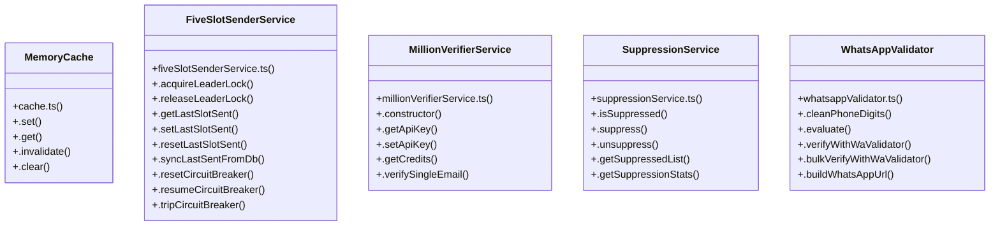

# [agentResult & { autonomousInboundAgent }] Cluster

> 96 nodes · cohesion 0.04

## Key Concepts

- [FiveSlotSenderService](file:///Users/ujjawal/Documents/ChatBot/Outreach-Dashboard/server/src/services/fiveSlotSenderService.ts#L66) (29 connections)
- [.sendNextStageToLead()](file:///Users/ujjawal/Documents/ChatBot/Outreach-Dashboard/server/src/services/stageOutreachService.ts#L220) (25 connections)
- [.processGlobalTick()](file:///Users/ujjawal/Documents/ChatBot/Outreach-Dashboard/server/src/services/fiveSlotSenderService.ts#L940) (24 connections)
- [.set()](file:///Users/ujjawal/Documents/ChatBot/Outreach-Dashboard/server/src/config/cache.ts#L12) (18 connections)
- [main()](file:///Users/ujjawal/Documents/ChatBot/Outreach-Dashboard/server/src/scripts/testB23Organic100Leads.ts#L11) (15 connections)
- [main()](file:///Users/ujjawal/Documents/ChatBot/Outreach-Dashboard/server/src/scripts/soak3HourGridTest.ts#L15) (14 connections)
- [main()](file:///Users/ujjawal/Documents/ChatBot/Outreach-Dashboard/server/src/scripts/testItem10EmailAndUnsubscribe.ts#L10) (13 connections)
- [db.ts](file:///Users/ujjawal/Documents/ChatBot/Outreach-Dashboard/server/src/config/db.ts#L1) (12 connections)
- [.triggerAuditForLead()](file:///Users/ujjawal/Documents/ChatBot/Outreach-Dashboard/server/src/services/fiveSlotSenderService.ts#L651) (11 connections)
- [.isSuppressed()](file:///Users/ujjawal/Documents/ChatBot/Outreach-Dashboard/server/src/services/suppressionService.ts#L34) (11 connections)
- [.getSettings()](file:///Users/ujjawal/Documents/ChatBot/Outreach-Dashboard/server/src/services/fiveSlotSenderService.ts#L208) (10 connections)
- [.isolateFailedLead()](file:///Users/ujjawal/Documents/ChatBot/Outreach-Dashboard/server/src/services/leadIsolationService.ts#L22) (10 connections)
- [.autoAssignUnassignedLeads()](file:///Users/ujjawal/Documents/ChatBot/Outreach-Dashboard/server/src/services/fiveSlotSenderService.ts#L529) (8 connections)
- [.handleDispatchFailure()](file:///Users/ujjawal/Documents/ChatBot/Outreach-Dashboard/server/src/services/fiveSlotSenderService.ts#L1434) (8 connections)
- [.suppress()](file:///Users/ujjawal/Documents/ChatBot/Outreach-Dashboard/server/src/services/suppressionService.ts#L125) (7 connections)
- [main()](file:///Users/ujjawal/Documents/ChatBot/Outreach-Dashboard/server/src/scripts/testItem1PdfLifecycleFollowup1.ts#L7) (7 connections)
- [main()](file:///Users/ujjawal/Documents/ChatBot/Outreach-Dashboard/server/src/scripts/testSchedulerAdvisoryLock.ts#L4) (7 connections)
- [assertNotProduction()](file:///Users/ujjawal/Documents/ChatBot/Outreach-Dashboard/server/src/config/db.ts#L80) (6 connections)
- [assertProductionImmutability()](file:///Users/ujjawal/Documents/ChatBot/Outreach-Dashboard/server/src/config/db.ts#L179) (6 connections)
- [computeProductionDatabaseMd5()](file:///Users/ujjawal/Documents/ChatBot/Outreach-Dashboard/server/src/config/db.ts#L131) (6 connections)
- [.logFailure()](file:///Users/ujjawal/Documents/ChatBot/Outreach-Dashboard/server/src/services/failureLogService.ts#L40) (6 connections)
- [.getSlotsStatus()](file:///Users/ujjawal/Documents/ChatBot/Outreach-Dashboard/server/src/services/fiveSlotSenderService.ts#L1720) (6 connections)
- [.runLocalAudit()](file:///Users/ujjawal/Documents/ChatBot/Outreach-Dashboard/server/src/services/fiveSlotSenderService.ts#L732) (6 connections)
- [MillionVerifierService](file:///Users/ujjawal/Documents/ChatBot/Outreach-Dashboard/server/src/services/millionVerifierService.ts#L30) (6 connections)
- [SuppressionService](file:///Users/ujjawal/Documents/ChatBot/Outreach-Dashboard/server/src/services/suppressionService.ts#L30) (6 connections)
- *... and 71 more nodes in this community*

## Class Diagram

## Relationships

- No strong cross-community connections detected

## Source Files

- [/Users/ujjawal/Documents/ChatBot/Outreach-Dashboard/server/src/adapters/emailAdapter.ts](file:///Users/ujjawal/Documents/ChatBot/Outreach-Dashboard/server/src/adapters/emailAdapter.ts)
- [/Users/ujjawal/Documents/ChatBot/Outreach-Dashboard/server/src/config/cache.ts](file:///Users/ujjawal/Documents/ChatBot/Outreach-Dashboard/server/src/config/cache.ts)
- [/Users/ujjawal/Documents/ChatBot/Outreach-Dashboard/server/src/config/db.ts](file:///Users/ujjawal/Documents/ChatBot/Outreach-Dashboard/server/src/config/db.ts)
- [/Users/ujjawal/Documents/ChatBot/Outreach-Dashboard/server/src/scripts/soak3HourGridTest.ts](file:///Users/ujjawal/Documents/ChatBot/Outreach-Dashboard/server/src/scripts/soak3HourGridTest.ts)
- [/Users/ujjawal/Documents/ChatBot/Outreach-Dashboard/server/src/scripts/testB23Organic100Leads.ts](file:///Users/ujjawal/Documents/ChatBot/Outreach-Dashboard/server/src/scripts/testB23Organic100Leads.ts)
- [/Users/ujjawal/Documents/ChatBot/Outreach-Dashboard/server/src/scripts/testItem10EmailAndUnsubscribe.ts](file:///Users/ujjawal/Documents/ChatBot/Outreach-Dashboard/server/src/scripts/testItem10EmailAndUnsubscribe.ts)
- [/Users/ujjawal/Documents/ChatBot/Outreach-Dashboard/server/src/scripts/testItem1PdfLifecycleFollowup1.ts](file:///Users/ujjawal/Documents/ChatBot/Outreach-Dashboard/server/src/scripts/testItem1PdfLifecycleFollowup1.ts)
- [/Users/ujjawal/Documents/ChatBot/Outreach-Dashboard/server/src/scripts/testSchedulerAdvisoryLock.ts](file:///Users/ujjawal/Documents/ChatBot/Outreach-Dashboard/server/src/scripts/testSchedulerAdvisoryLock.ts)
- [/Users/ujjawal/Documents/ChatBot/Outreach-Dashboard/server/src/services/failureLogService.ts](file:///Users/ujjawal/Documents/ChatBot/Outreach-Dashboard/server/src/services/failureLogService.ts)
- [/Users/ujjawal/Documents/ChatBot/Outreach-Dashboard/server/src/services/fiveSlotSenderService.ts](file:///Users/ujjawal/Documents/ChatBot/Outreach-Dashboard/server/src/services/fiveSlotSenderService.ts)
- [/Users/ujjawal/Documents/ChatBot/Outreach-Dashboard/server/src/services/leadIsolationService.ts](file:///Users/ujjawal/Documents/ChatBot/Outreach-Dashboard/server/src/services/leadIsolationService.ts)
- [/Users/ujjawal/Documents/ChatBot/Outreach-Dashboard/server/src/services/millionVerifierService.ts](file:///Users/ujjawal/Documents/ChatBot/Outreach-Dashboard/server/src/services/millionVerifierService.ts)
- [/Users/ujjawal/Documents/ChatBot/Outreach-Dashboard/server/src/services/stageOutreachService.ts](file:///Users/ujjawal/Documents/ChatBot/Outreach-Dashboard/server/src/services/stageOutreachService.ts)
- [/Users/ujjawal/Documents/ChatBot/Outreach-Dashboard/server/src/services/suppressionService.ts](file:///Users/ujjawal/Documents/ChatBot/Outreach-Dashboard/server/src/services/suppressionService.ts)
- [/Users/ujjawal/Documents/ChatBot/Outreach-Dashboard/server/src/services/whatsappValidator.ts](file:///Users/ujjawal/Documents/ChatBot/Outreach-Dashboard/server/src/services/whatsappValidator.ts)
- [/Users/ujjawal/Documents/ChatBot/Outreach-Dashboard/server/src/utils/auditPolicy.ts](file:///Users/ujjawal/Documents/ChatBot/Outreach-Dashboard/server/src/utils/auditPolicy.ts)
- [/Users/ujjawal/Documents/ChatBot/Outreach-Dashboard/server/src/utils/timezoneHelper.ts](file:///Users/ujjawal/Documents/ChatBot/Outreach-Dashboard/server/src/utils/timezoneHelper.ts)
- [/Users/ujjawal/Documents/ChatBot/Outreach-Dashboard/tests/suppression.test.ts](file:///Users/ujjawal/Documents/ChatBot/Outreach-Dashboard/tests/suppression.test.ts)

## Audit Trail

- EXTRACTED: 228 (50%)
- INFERRED: 228 (50%)
- AMBIGUOUS: 0 (0%)

---

*Part of the graphify knowledge wiki. See [[index]] to navigate.*