# [allIds & allLeadsRes] Cluster

> 133 nodes · cohesion 0.02

## Key Concepts

- [query()](file:///Users/ujjawal/Documents/ChatBot/Outreach-Dashboard/server/src/config/db.ts#L43) (126 connections)
- [LinkedInService](file:///Users/ujjawal/Documents/ChatBot/Outreach-Dashboard/server/src/services/linkedinService.ts#L52) (27 connections)
- [EmailInboundService](file:///Users/ujjawal/Documents/ChatBot/Outreach-Dashboard/server/src/services/emailInboundService.ts#L22) (10 connections)
- [.syncInboundEmails()](file:///Users/ujjawal/Documents/ChatBot/Outreach-Dashboard/server/src/services/emailInboundService.ts#L258) (9 connections)
- [.processInboundMessage()](file:///Users/ujjawal/Documents/ChatBot/Outreach-Dashboard/server/src/services/autonomousInboundAgent.ts#L43) (7 connections)
- [.getAccountStatus()](file:///Users/ujjawal/Documents/ChatBot/Outreach-Dashboard/server/src/services/linkedinService.ts#L93) (7 connections)
- [.routeOutreachMessage()](file:///Users/ujjawal/Documents/ChatBot/Outreach-Dashboard/server/src/services/outreachService.ts#L156) (7 connections)
- [AiCommandService](file:///Users/ujjawal/Documents/ChatBot/Outreach-Dashboard/server/src/services/aiCommandService.ts#L58) (6 connections)
- [.executeLinkedInDispatch()](file:///Users/ujjawal/Documents/ChatBot/Outreach-Dashboard/server/src/services/emailSchedulerService.ts#L2018) (6 connections)
- [.createPost()](file:///Users/ujjawal/Documents/ChatBot/Outreach-Dashboard/server/src/services/linkedinService.ts#L754) (6 connections)
- [.publishExistingPost()](file:///Users/ujjawal/Documents/ChatBot/Outreach-Dashboard/server/src/services/linkedinService.ts#L820) (6 connections)
- [SequenceEnrollmentService](file:///Users/ujjawal/Documents/ChatBot/Outreach-Dashboard/server/src/services/sequenceEnrollmentService.ts#L17) (6 connections)
- [.enqueueDraft()](file:///Users/ujjawal/Documents/ChatBot/Outreach-Dashboard/server/src/adapters/instagramAdapter.ts#L26) (5 connections)
- [.checkAndResetQuotas()](file:///Users/ujjawal/Documents/ChatBot/Outreach-Dashboard/server/src/services/linkedinService.ts#L59) (5 connections)
- [.getAllAccounts()](file:///Users/ujjawal/Documents/ChatBot/Outreach-Dashboard/server/src/services/linkedinService.ts#L203) (5 connections)
- [.mapPostRow()](file:///Users/ujjawal/Documents/ChatBot/Outreach-Dashboard/server/src/services/linkedinService.ts#L1209) (5 connections)
- [.processScheduledPosts()](file:///Users/ujjawal/Documents/ChatBot/Outreach-Dashboard/server/src/services/linkedinService.ts#L929) (5 connections)
- [.extractBouncedRecipient()](file:///Users/ujjawal/Documents/ChatBot/Outreach-Dashboard/server/src/services/emailInboundService.ts#L75) (4 connections)
- [.isAutomatedOrMarketingEmail()](file:///Users/ujjawal/Documents/ChatBot/Outreach-Dashboard/server/src/services/emailInboundService.ts#L145) (4 connections)
- [FacebookAdapter](file:///Users/ujjawal/Documents/ChatBot/Outreach-Dashboard/server/src/adapters/facebookAdapter.ts#L21) (4 connections)
- [.addProspectPostToMonitor()](file:///Users/ujjawal/Documents/ChatBot/Outreach-Dashboard/server/src/services/linkedinService.ts#L1126) (4 connections)
- [.approveAndPostComment()](file:///Users/ujjawal/Documents/ChatBot/Outreach-Dashboard/server/src/services/linkedinService.ts#L1081) (4 connections)
- [.generateCommentForPost()](file:///Users/ujjawal/Documents/ChatBot/Outreach-Dashboard/server/src/services/linkedinService.ts#L1049) (4 connections)
- [.getAccountCredentials()](file:///Users/ujjawal/Documents/ChatBot/Outreach-Dashboard/server/src/services/linkedinService.ts#L76) (4 connections)
- [.getPosts()](file:///Users/ujjawal/Documents/ChatBot/Outreach-Dashboard/server/src/services/linkedinService.ts#L982) (4 connections)
- *... and 108 more nodes in this community*

## Class Diagram

```mermaid
classDiagram
    class AiCommandService {
        +aiCommandService.ts()
        +.getBusinessSuggestions()
        +.saveCommandHistory()
        +.getCommandHistory()
        +.clearCommandHistory()
        +.executeCommand()
    }
    class AutonomousInboundAgent {
        +autonomousInboundAgent.ts()
        +.getSettings()
        +.processInboundMessage()
    }
    class EmailInboundService {
        +emailInboundService.ts()
        +.extractCleanReply()
        +.extractBouncedRecipient()
        +.isAutomatedOrMarketingEmail()
        +.syncInboundEmails()
        +.startPolling()
        +.getUnmatchedInboundEmails()
        +.dismissUnmatchedEmail()
        +.clearAllUnmatchedEmails()
        +.stopPolling()
    }
    class FacebookAdapter {
        +facebookAdapter.ts()
        +.buildMessengerDeepLink()
        +.enqueueDraft()
        +.markDraftSent()
    }
    class InstagramAdapter {
        +instagramAdapter.ts()
        +.enqueueDraft()
        +.markDraftSent()
    }
    class LinkedInService {
        +linkedinService.ts()
        +.checkAndResetQuotas()
        +.getAccountCredentials()
        +.getAccountStatus()
        +.connectAccount()
        +.disconnectAccount()
        +.getAllAccounts()
        +.addAccount()
        +.deleteAccount()
        +.generatePost()
    }
    class ConversationOrchestratorService {
        +orchestratorService.ts()
        +.convertLeadToClient()
        +.processClientFollowUps()
    }
    class OutreachEngineService {
        +outreachService.ts()
        +.handleInboundLeadMessage()
        +.checkDeliverabilityThrottled()
        +.routeOutreachMessage()
    }
    class SequenceEnrollmentService {
        +sequenceEnrollmentService.ts()
        +.enrollLead()
        +.advanceStep()
        +.delayForOoo()
        +.updateStatusForLead()
        +.getLeadEnrollments()
    }
    class WhatsAppAdapter {
        +whatsappAdapter.ts()
        +.check24HourWindow()
        +.verifyAndSend()
        +.handleInboundWebhook()
    }
```

## Relationships

- No strong cross-community connections detected

## Source Files

- [/Users/ujjawal/Documents/ChatBot/Outreach-Dashboard/server/src/adapters/facebookAdapter.ts](file:///Users/ujjawal/Documents/ChatBot/Outreach-Dashboard/server/src/adapters/facebookAdapter.ts)
- [/Users/ujjawal/Documents/ChatBot/Outreach-Dashboard/server/src/adapters/instagramAdapter.ts](file:///Users/ujjawal/Documents/ChatBot/Outreach-Dashboard/server/src/adapters/instagramAdapter.ts)
- [/Users/ujjawal/Documents/ChatBot/Outreach-Dashboard/server/src/adapters/whatsappAdapter.ts](file:///Users/ujjawal/Documents/ChatBot/Outreach-Dashboard/server/src/adapters/whatsappAdapter.ts)
- [/Users/ujjawal/Documents/ChatBot/Outreach-Dashboard/server/src/config/db.ts](file:///Users/ujjawal/Documents/ChatBot/Outreach-Dashboard/server/src/config/db.ts)
- [/Users/ujjawal/Documents/ChatBot/Outreach-Dashboard/server/src/db/add_ai_command_history.ts](file:///Users/ujjawal/Documents/ChatBot/Outreach-Dashboard/server/src/db/add_ai_command_history.ts)
- [/Users/ujjawal/Documents/ChatBot/Outreach-Dashboard/server/src/db/add_automated_cadence_and_channel_lists.ts](file:///Users/ujjawal/Documents/ChatBot/Outreach-Dashboard/server/src/db/add_automated_cadence_and_channel_lists.ts)
- [/Users/ujjawal/Documents/ChatBot/Outreach-Dashboard/server/src/db/add_batches_and_retention.ts](file:///Users/ujjawal/Documents/ChatBot/Outreach-Dashboard/server/src/db/add_batches_and_retention.ts)
- [/Users/ujjawal/Documents/ChatBot/Outreach-Dashboard/server/src/db/add_channel_auto_assignment_trigger.ts](file:///Users/ujjawal/Documents/ChatBot/Outreach-Dashboard/server/src/db/add_channel_auto_assignment_trigger.ts)
- [/Users/ujjawal/Documents/ChatBot/Outreach-Dashboard/server/src/db/add_deals_tasks_and_activities.ts](file:///Users/ujjawal/Documents/ChatBot/Outreach-Dashboard/server/src/db/add_deals_tasks_and_activities.ts)
- [/Users/ujjawal/Documents/ChatBot/Outreach-Dashboard/server/src/db/add_extreme_automation.ts](file:///Users/ujjawal/Documents/ChatBot/Outreach-Dashboard/server/src/db/add_extreme_automation.ts)
- [/Users/ujjawal/Documents/ChatBot/Outreach-Dashboard/server/src/db/add_facebook_and_whatsapp_eligibility.ts](file:///Users/ujjawal/Documents/ChatBot/Outreach-Dashboard/server/src/db/add_facebook_and_whatsapp_eligibility.ts)
- [/Users/ujjawal/Documents/ChatBot/Outreach-Dashboard/server/src/db/add_inbound_email_sync.ts](file:///Users/ujjawal/Documents/ChatBot/Outreach-Dashboard/server/src/db/add_inbound_email_sync.ts)
- [/Users/ujjawal/Documents/ChatBot/Outreach-Dashboard/server/src/db/add_inbox_rotation_and_trigram_indexes.ts](file:///Users/ujjawal/Documents/ChatBot/Outreach-Dashboard/server/src/db/add_inbox_rotation_and_trigram_indexes.ts)
- [/Users/ujjawal/Documents/ChatBot/Outreach-Dashboard/server/src/db/add_lead_status_and_client_soft_delete.ts](file:///Users/ujjawal/Documents/ChatBot/Outreach-Dashboard/server/src/db/add_lead_status_and_client_soft_delete.ts)
- [/Users/ujjawal/Documents/ChatBot/Outreach-Dashboard/server/src/db/add_linkedin_publishing_columns.ts](file:///Users/ujjawal/Documents/ChatBot/Outreach-Dashboard/server/src/db/add_linkedin_publishing_columns.ts)
- [/Users/ujjawal/Documents/ChatBot/Outreach-Dashboard/server/src/db/add_linkedin_tables.ts](file:///Users/ujjawal/Documents/ChatBot/Outreach-Dashboard/server/src/db/add_linkedin_tables.ts)
- [/Users/ujjawal/Documents/ChatBot/Outreach-Dashboard/server/src/db/add_lists_and_cleanup.ts](file:///Users/ujjawal/Documents/ChatBot/Outreach-Dashboard/server/src/db/add_lists_and_cleanup.ts)
- [/Users/ujjawal/Documents/ChatBot/Outreach-Dashboard/server/src/db/add_location_and_clean_websites.ts](file:///Users/ujjawal/Documents/ChatBot/Outreach-Dashboard/server/src/db/add_location_and_clean_websites.ts)
- [/Users/ujjawal/Documents/ChatBot/Outreach-Dashboard/server/src/db/add_manual_review_status.ts](file:///Users/ujjawal/Documents/ChatBot/Outreach-Dashboard/server/src/db/add_manual_review_status.ts)
- [/Users/ujjawal/Documents/ChatBot/Outreach-Dashboard/server/src/db/add_multichannel_scheduling.ts](file:///Users/ujjawal/Documents/ChatBot/Outreach-Dashboard/server/src/db/add_multichannel_scheduling.ts)

## Audit Trail

- EXTRACTED: 257 (52%)
- INFERRED: 236 (48%)
- AMBIGUOUS: 0 (0%)

---

*Part of the graphify knowledge wiki. See [[index]] to navigate.*