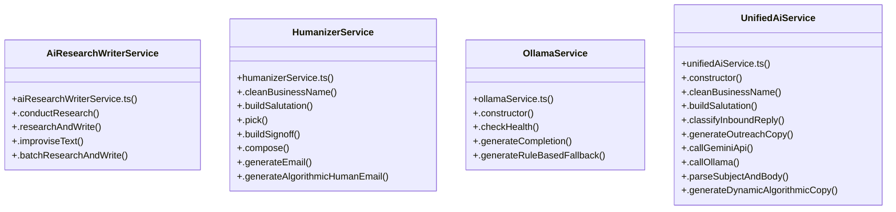

# [auditRouter & auditsDir] Cluster

> 51 nodes · cohesion 0.07

## Key Concepts

- [suppression.ts](file:///Users/ujjawal/Documents/ChatBot/Outreach-Dashboard/server/src/routes/suppression.ts#L1) (13 connections)
- [.researchAndWrite()](file:///Users/ujjawal/Documents/ChatBot/Outreach-Dashboard/server/src/services/aiResearchWriterService.ts#L152) (11 connections)
- [.generateEmail()](file:///Users/ujjawal/Documents/ChatBot/Outreach-Dashboard/server/src/services/humanizerService.ts#L81) (11 connections)
- [UnifiedAiService](file:///Users/ujjawal/Documents/ChatBot/Outreach-Dashboard/server/src/services/unifiedAiService.ts#L27) (10 connections)
- [.generateCompletion()](file:///Users/ujjawal/Documents/ChatBot/Outreach-Dashboard/server/src/services/ollamaService.ts#L54) (9 connections)
- [HumanizerService](file:///Users/ujjawal/Documents/ChatBot/Outreach-Dashboard/server/src/services/humanizerService.ts#L19) (8 connections)
- [.checkHealth()](file:///Users/ujjawal/Documents/ChatBot/Outreach-Dashboard/server/src/services/ollamaService.ts#L28) (8 connections)
- [.generateOutreachCopy()](file:///Users/ujjawal/Documents/ChatBot/Outreach-Dashboard/server/src/services/unifiedAiService.ts#L214) (8 connections)
- [.improviseText()](file:///Users/ujjawal/Documents/ChatBot/Outreach-Dashboard/server/src/services/aiResearchWriterService.ts#L300) (7 connections)
- [.generateAlgorithmicHumanEmail()](file:///Users/ujjawal/Documents/ChatBot/Outreach-Dashboard/server/src/services/humanizerService.ts#L243) (6 connections)
- [.classifyInboundReply()](file:///Users/ujjawal/Documents/ChatBot/Outreach-Dashboard/server/src/services/unifiedAiService.ts#L67) (6 connections)
- [AiResearchWriterService](file:///Users/ujjawal/Documents/ChatBot/Outreach-Dashboard/server/src/services/aiResearchWriterService.ts#L43) (5 connections)
- [.buildSalutation()](file:///Users/ujjawal/Documents/ChatBot/Outreach-Dashboard/server/src/services/humanizerService.ts#L39) (5 connections)
- [.cleanBusinessName()](file:///Users/ujjawal/Documents/ChatBot/Outreach-Dashboard/server/src/services/humanizerService.ts#L25) (5 connections)
- [.generatePost()](file:///Users/ujjawal/Documents/ChatBot/Outreach-Dashboard/server/src/services/linkedinService.ts#L302) (5 connections)
- [OllamaService](file:///Users/ujjawal/Documents/ChatBot/Outreach-Dashboard/server/src/services/ollamaService.ts#L16) (5 connections)
- [.conductResearch()](file:///Users/ujjawal/Documents/ChatBot/Outreach-Dashboard/server/src/services/aiResearchWriterService.ts#L47) (4 connections)
- [.buildSignoff()](file:///Users/ujjawal/Documents/ChatBot/Outreach-Dashboard/server/src/services/humanizerService.ts#L70) (4 connections)
- [.buildSalutation()](file:///Users/ujjawal/Documents/ChatBot/Outreach-Dashboard/server/src/services/unifiedAiService.ts#L50) (4 connections)
- [.callOllama()](file:///Users/ujjawal/Documents/ChatBot/Outreach-Dashboard/server/src/services/unifiedAiService.ts#L320) (4 connections)
- [.cleanBusinessName()](file:///Users/ujjawal/Documents/ChatBot/Outreach-Dashboard/server/src/services/unifiedAiService.ts#L37) (4 connections)
- [.compose()](file:///Users/ujjawal/Documents/ChatBot/Outreach-Dashboard/server/src/services/humanizerService.ts#L74) (3 connections)
- [.pick()](file:///Users/ujjawal/Documents/ChatBot/Outreach-Dashboard/server/src/services/humanizerService.ts#L63) (3 connections)
- [runInboundIntentTests()](file:///Users/ujjawal/Documents/ChatBot/Outreach-Dashboard/tests/inbound-intent.test.ts#L4) (3 connections)
- [.callGeminiApi()](file:///Users/ujjawal/Documents/ChatBot/Outreach-Dashboard/server/src/services/unifiedAiService.ts#L276) (3 connections)
- *... and 26 more nodes in this community*

## Class Diagram

## Relationships

- No strong cross-community connections detected

## Source Files

- [/Users/ujjawal/Documents/ChatBot/Outreach-Dashboard/server/src/routes/suppression.ts](file:///Users/ujjawal/Documents/ChatBot/Outreach-Dashboard/server/src/routes/suppression.ts)
- [/Users/ujjawal/Documents/ChatBot/Outreach-Dashboard/server/src/services/aiResearchWriterService.ts](file:///Users/ujjawal/Documents/ChatBot/Outreach-Dashboard/server/src/services/aiResearchWriterService.ts)
- [/Users/ujjawal/Documents/ChatBot/Outreach-Dashboard/server/src/services/humanizerService.ts](file:///Users/ujjawal/Documents/ChatBot/Outreach-Dashboard/server/src/services/humanizerService.ts)
- [/Users/ujjawal/Documents/ChatBot/Outreach-Dashboard/server/src/services/linkedinService.ts](file:///Users/ujjawal/Documents/ChatBot/Outreach-Dashboard/server/src/services/linkedinService.ts)
- [/Users/ujjawal/Documents/ChatBot/Outreach-Dashboard/server/src/services/ollamaService.ts](file:///Users/ujjawal/Documents/ChatBot/Outreach-Dashboard/server/src/services/ollamaService.ts)
- [/Users/ujjawal/Documents/ChatBot/Outreach-Dashboard/server/src/services/unifiedAiService.ts](file:///Users/ujjawal/Documents/ChatBot/Outreach-Dashboard/server/src/services/unifiedAiService.ts)
- [/Users/ujjawal/Documents/ChatBot/Outreach-Dashboard/src/components/ScheduleOutreachModal.tsx](file:///Users/ujjawal/Documents/ChatBot/Outreach-Dashboard/src/components/ScheduleOutreachModal.tsx)
- [/Users/ujjawal/Documents/ChatBot/Outreach-Dashboard/tests/inbound-intent.test.ts](file:///Users/ujjawal/Documents/ChatBot/Outreach-Dashboard/tests/inbound-intent.test.ts)

## Audit Trail

- EXTRACTED: 136 (72%)
- INFERRED: 53 (28%)
- AMBIGUOUS: 0 (0%)

---

*Part of the graphify knowledge wiki. See [[index]] to navigate.*