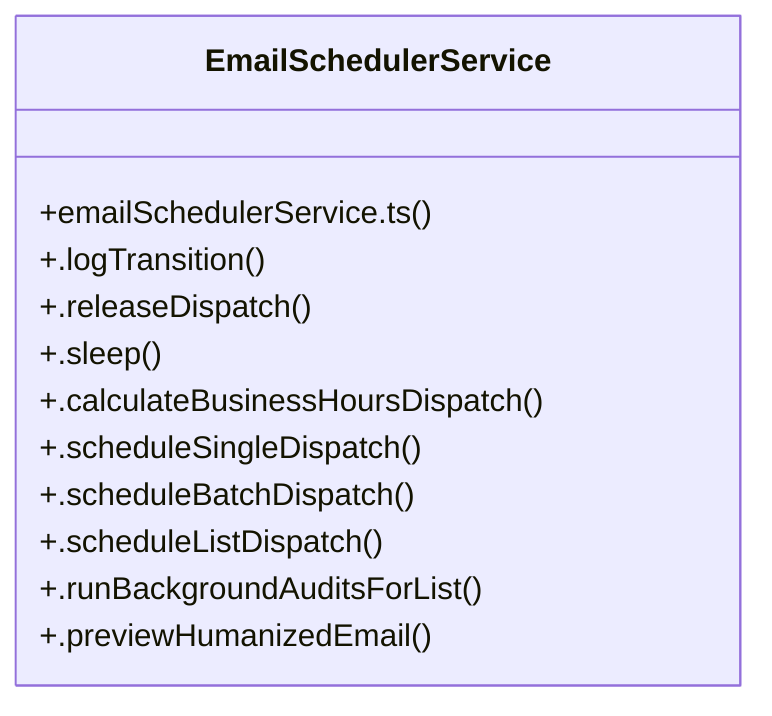

# [baseItems & dealItems] Cluster

> 17 nodes · cohesion 0.24

## Key Concepts

- [EmailSchedulerService](file:///Users/ujjawal/Documents/ChatBot/Outreach-Dashboard/server/src/services/emailSchedulerService.ts#L77) (21 connections)
- [.executeEmailDispatch()](file:///Users/ujjawal/Documents/ChatBot/Outreach-Dashboard/server/src/services/emailSchedulerService.ts#L1488) (17 connections)
- [.executeWhatsAppDispatch()](file:///Users/ujjawal/Documents/ChatBot/Outreach-Dashboard/server/src/services/emailSchedulerService.ts#L1312) (10 connections)
- [.logTransition()](file:///Users/ujjawal/Documents/ChatBot/Outreach-Dashboard/server/src/services/emailSchedulerService.ts#L84) (9 connections)
- [.processPendingDispatches()](file:///Users/ujjawal/Documents/ChatBot/Outreach-Dashboard/server/src/services/emailSchedulerService.ts#L1240) (6 connections)
- [.releaseDispatch()](file:///Users/ujjawal/Documents/ChatBot/Outreach-Dashboard/server/src/services/emailSchedulerService.ts#L89) (6 connections)
- [.recoverStaleDispatches()](file:///Users/ujjawal/Documents/ChatBot/Outreach-Dashboard/server/src/services/emailSchedulerService.ts#L2079) (4 connections)
- [.cancelDispatch()](file:///Users/ujjawal/Documents/ChatBot/Outreach-Dashboard/server/src/services/emailSchedulerService.ts#L2003) (3 connections)
- [.retryDispatch()](file:///Users/ujjawal/Documents/ChatBot/Outreach-Dashboard/server/src/services/emailSchedulerService.ts#L2020) (3 connections)
- [.sleep()](file:///Users/ujjawal/Documents/ChatBot/Outreach-Dashboard/server/src/services/emailSchedulerService.ts#L144) (3 connections)
- [.calculateBusinessHoursDispatch()](file:///Users/ujjawal/Documents/ChatBot/Outreach-Dashboard/server/src/services/emailSchedulerService.ts#L151) (2 connections)
- [.deleteDispatches()](file:///Users/ujjawal/Documents/ChatBot/Outreach-Dashboard/server/src/services/emailSchedulerService.ts#L2065) (2 connections)
- [.getDispatches()](file:///Users/ujjawal/Documents/ChatBot/Outreach-Dashboard/server/src/services/emailSchedulerService.ts#L1974) (2 connections)
- [.runBackgroundAuditsForList()](file:///Users/ujjawal/Documents/ChatBot/Outreach-Dashboard/server/src/services/emailSchedulerService.ts#L1000) (2 connections)
- [.startScheduler()](file:///Users/ujjawal/Documents/ChatBot/Outreach-Dashboard/server/src/services/emailSchedulerService.ts#L2168) (2 connections)
- [.stopScheduler()](file:///Users/ujjawal/Documents/ChatBot/Outreach-Dashboard/server/src/services/emailSchedulerService.ts#L2200) (1 connections)
- [emailSchedulerService.ts](file:///Users/ujjawal/Documents/ChatBot/Outreach-Dashboard/server/src/services/emailSchedulerService.ts#L1) (1 connections)

## Class Diagram

## Relationships

- No strong cross-community connections detected

## Source Files

- [/Users/ujjawal/Documents/ChatBot/Outreach-Dashboard/server/src/services/emailSchedulerService.ts](file:///Users/ujjawal/Documents/ChatBot/Outreach-Dashboard/server/src/services/emailSchedulerService.ts)

## Audit Trail

- EXTRACTED: 71 (76%)
- INFERRED: 23 (24%)
- AMBIGUOUS: 0 (0%)

---

*Part of the graphify knowledge wiki. See [[index]] to navigate.*