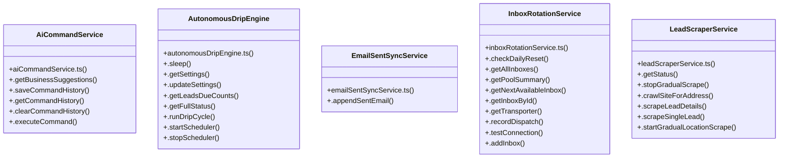

# [fetchQueue() & handleDeleteFailedDispatches()] Cluster

> 46 nodes · cohesion 0.06

## Key Concepts

- [InboxRotationService](file:///Users/ujjawal/Documents/ChatBot/Outreach-Dashboard/server/src/services/inboxRotationService.ts#L39) (12 connections)
- [.executeCommand()](file:///Users/ujjawal/Documents/ChatBot/Outreach-Dashboard/server/src/services/aiCommandService.ts#L430) (10 connections)
- [AutonomousDripEngine](file:///Users/ujjawal/Documents/ChatBot/Outreach-Dashboard/server/src/services/autonomousDripEngine.ts#L47) (9 connections)
- [LeadScraperService](file:///Users/ujjawal/Documents/ChatBot/Outreach-Dashboard/server/src/services/leadScraperService.ts#L206) (7 connections)
- [AiCommandService](file:///Users/ujjawal/Documents/ChatBot/Outreach-Dashboard/server/src/services/aiCommandService.ts#L58) (6 connections)
- [.getAllInboxes()](file:///Users/ujjawal/Documents/ChatBot/Outreach-Dashboard/server/src/services/inboxRotationService.ts#L63) (6 connections)
- [.getPoolSummary()](file:///Users/ujjawal/Documents/ChatBot/Outreach-Dashboard/server/src/services/inboxRotationService.ts#L106) (6 connections)
- [.runDripCycle()](file:///Users/ujjawal/Documents/ChatBot/Outreach-Dashboard/server/src/services/autonomousDripEngine.ts#L276) (5 connections)
- [.appendSentEmail()](file:///Users/ujjawal/Documents/ChatBot/Outreach-Dashboard/server/src/services/emailSentSyncService.ts#L24) (5 connections)
- [.checkDailyReset()](file:///Users/ujjawal/Documents/ChatBot/Outreach-Dashboard/server/src/services/inboxRotationService.ts#L45) (5 connections)
- [.getTransporter()](file:///Users/ujjawal/Documents/ChatBot/Outreach-Dashboard/server/src/services/inboxRotationService.ts#L182) (5 connections)
- [cleanSiteUrl()](file:///Users/ujjawal/Documents/ChatBot/Outreach-Dashboard/server/src/services/leadScraperService.ts#L3) (5 connections)
- [.crawlSiteForAddress()](file:///Users/ujjawal/Documents/ChatBot/Outreach-Dashboard/server/src/services/leadScraperService.ts#L232) (5 connections)
- [.scrapeLeadDetails()](file:///Users/ujjawal/Documents/ChatBot/Outreach-Dashboard/server/src/services/leadScraperService.ts#L311) (5 connections)
- [leadScraperService.ts](file:///Users/ujjawal/Documents/ChatBot/Outreach-Dashboard/server/src/services/leadScraperService.ts#L1) (5 connections)
- [.getFullStatus()](file:///Users/ujjawal/Documents/ChatBot/Outreach-Dashboard/server/src/services/autonomousDripEngine.ts#L209) (4 connections)
- [.getSettings()](file:///Users/ujjawal/Documents/ChatBot/Outreach-Dashboard/server/src/services/autonomousDripEngine.ts#L63) (4 connections)
- [list](file:///Users/ujjawal/Documents/ChatBot/Outreach-Dashboard/src/pages/CrmPage.tsx#L1013) (4 connections)
- [.scrapeSingleLead()](file:///Users/ujjawal/Documents/ChatBot/Outreach-Dashboard/server/src/services/leadScraperService.ts#L531) (4 connections)
- [.saveCommandHistory()](file:///Users/ujjawal/Documents/ChatBot/Outreach-Dashboard/server/src/services/aiCommandService.ts#L335) (3 connections)
- [.updateSettings()](file:///Users/ujjawal/Documents/ChatBot/Outreach-Dashboard/server/src/services/autonomousDripEngine.ts#L103) (3 connections)
- [.getInboxById()](file:///Users/ujjawal/Documents/ChatBot/Outreach-Dashboard/server/src/services/inboxRotationService.ts#L174) (3 connections)
- [.getNextAvailableInbox()](file:///Users/ujjawal/Documents/ChatBot/Outreach-Dashboard/server/src/services/inboxRotationService.ts#L148) (3 connections)
- [.recordDispatch()](file:///Users/ujjawal/Documents/ChatBot/Outreach-Dashboard/server/src/services/inboxRotationService.ts#L239) (3 connections)
- [.testConnection()](file:///Users/ujjawal/Documents/ChatBot/Outreach-Dashboard/server/src/services/inboxRotationService.ts#L272) (3 connections)
- *... and 21 more nodes in this community*

## Class Diagram

## Relationships

- No strong cross-community connections detected

## Source Files

- [/Users/ujjawal/Documents/ChatBot/Outreach-Dashboard/server/src/services/aiCommandService.ts](file:///Users/ujjawal/Documents/ChatBot/Outreach-Dashboard/server/src/services/aiCommandService.ts)
- [/Users/ujjawal/Documents/ChatBot/Outreach-Dashboard/server/src/services/autonomousDripEngine.ts](file:///Users/ujjawal/Documents/ChatBot/Outreach-Dashboard/server/src/services/autonomousDripEngine.ts)
- [/Users/ujjawal/Documents/ChatBot/Outreach-Dashboard/server/src/services/emailSentSyncService.ts](file:///Users/ujjawal/Documents/ChatBot/Outreach-Dashboard/server/src/services/emailSentSyncService.ts)
- [/Users/ujjawal/Documents/ChatBot/Outreach-Dashboard/server/src/services/inboxRotationService.ts](file:///Users/ujjawal/Documents/ChatBot/Outreach-Dashboard/server/src/services/inboxRotationService.ts)
- [/Users/ujjawal/Documents/ChatBot/Outreach-Dashboard/server/src/services/leadScraperService.ts](file:///Users/ujjawal/Documents/ChatBot/Outreach-Dashboard/server/src/services/leadScraperService.ts)
- [/Users/ujjawal/Documents/ChatBot/Outreach-Dashboard/src/pages/CrmPage.tsx](file:///Users/ujjawal/Documents/ChatBot/Outreach-Dashboard/src/pages/CrmPage.tsx)

## Audit Trail

- EXTRACTED: 115 (70%)
- INFERRED: 49 (30%)
- AMBIGUOUS: 0 (0%)

---

*Part of the graphify knowledge wiki. See [[index]] to navigate.*