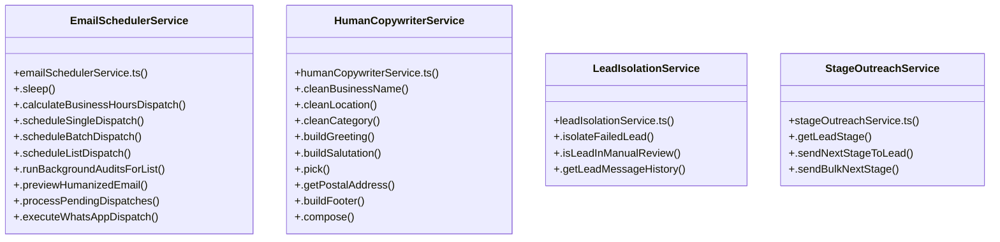

# [fetchRecentMessages & handleSyncClick()] Cluster

> 78 nodes · cohesion 0.04

## Key Concepts

- [ClientAuditModal.tsx](file:///Users/ujjawal/Documents/ChatBot/Outreach-Dashboard/src/components/ClientAuditModal.tsx#L1) (34 connections)
- [EmailSchedulerService](file:///Users/ujjawal/Documents/ChatBot/Outreach-Dashboard/server/src/services/emailSchedulerService.ts#L72) (21 connections)
- [.getEmailCopy()](file:///Users/ujjawal/Documents/ChatBot/Outreach-Dashboard/server/src/services/humanCopywriterService.ts#L178) (18 connections)
- [.executeEmailDispatch()](file:///Users/ujjawal/Documents/ChatBot/Outreach-Dashboard/server/src/services/emailSchedulerService.ts#L1435) (14 connections)
- [HumanCopywriterService](file:///Users/ujjawal/Documents/ChatBot/Outreach-Dashboard/server/src/services/humanCopywriterService.ts#L36) (11 connections)
- [.scheduleListDispatch()](file:///Users/ujjawal/Documents/ChatBot/Outreach-Dashboard/server/src/services/emailSchedulerService.ts#L540) (10 connections)
- [.executeWhatsAppDispatch()](file:///Users/ujjawal/Documents/ChatBot/Outreach-Dashboard/server/src/services/emailSchedulerService.ts#L1261) (8 connections)
- [.processPendingDispatches()](file:///Users/ujjawal/Documents/ChatBot/Outreach-Dashboard/server/src/services/emailSchedulerService.ts#L1193) (7 connections)
- [.getLeadMessageHistory()](file:///Users/ujjawal/Documents/ChatBot/Outreach-Dashboard/server/src/services/leadIsolationService.ts#L130) (7 connections)
- [.scheduleBatchDispatch()](file:///Users/ujjawal/Documents/ChatBot/Outreach-Dashboard/server/src/services/emailSchedulerService.ts#L292) (6 connections)
- [.scheduleSingleDispatch()](file:///Users/ujjawal/Documents/ChatBot/Outreach-Dashboard/server/src/services/emailSchedulerService.ts#L110) (6 connections)
- [.executeFacebookDispatch()](file:///Users/ujjawal/Documents/ChatBot/Outreach-Dashboard/server/src/services/emailSchedulerService.ts#L1916) (5 connections)
- [.executeInstagramDispatch()](file:///Users/ujjawal/Documents/ChatBot/Outreach-Dashboard/server/src/services/emailSchedulerService.ts#L1967) (5 connections)
- [.buildGreeting()](file:///Users/ujjawal/Documents/ChatBot/Outreach-Dashboard/server/src/services/humanCopywriterService.ts#L96) (5 connections)
- [handleSchedule()](file:///Users/ujjawal/Documents/ChatBot/Outreach-Dashboard/src/components/ScheduleOutreachModal.tsx#L204) (5 connections)
- [.sleep()](file:///Users/ujjawal/Documents/ChatBot/Outreach-Dashboard/server/src/services/emailSchedulerService.ts#L79) (4 connections)
- [.getPostalAddress()](file:///Users/ujjawal/Documents/ChatBot/Outreach-Dashboard/server/src/services/humanCopywriterService.ts#L144) (4 connections)
- [LeadIsolationService](file:///Users/ujjawal/Documents/ChatBot/Outreach-Dashboard/server/src/services/leadIsolationService.ts#L14) (4 connections)
- [.isLeadInManualReview()](file:///Users/ujjawal/Documents/ChatBot/Outreach-Dashboard/server/src/services/leadIsolationService.ts#L101) (4 connections)
- [StageOutreachService](file:///Users/ujjawal/Documents/ChatBot/Outreach-Dashboard/server/src/services/stageOutreachService.ts#L55) (4 connections)
- [.getLeadStage()](file:///Users/ujjawal/Documents/ChatBot/Outreach-Dashboard/server/src/services/stageOutreachService.ts#L61) (4 connections)
- [handleSendBulkList()](file:///Users/ujjawal/Documents/ChatBot/Outreach-Dashboard/src/components/ClientAuditModal.tsx#L124) (3 connections)
- [.buildFooter()](file:///Users/ujjawal/Documents/ChatBot/Outreach-Dashboard/server/src/services/humanCopywriterService.ts#L166) (3 connections)
- [.buildSalutation()](file:///Users/ujjawal/Documents/ChatBot/Outreach-Dashboard/server/src/services/humanCopywriterService.ts#L128) (3 connections)
- [.cleanBusinessName()](file:///Users/ujjawal/Documents/ChatBot/Outreach-Dashboard/server/src/services/humanCopywriterService.ts#L44) (3 connections)
- *... and 53 more nodes in this community*

## Class Diagram

## Relationships

- No strong cross-community connections detected

## Source Files

- [/Users/ujjawal/Documents/ChatBot/Outreach-Dashboard/server/src/services/emailSchedulerService.ts](file:///Users/ujjawal/Documents/ChatBot/Outreach-Dashboard/server/src/services/emailSchedulerService.ts)
- [/Users/ujjawal/Documents/ChatBot/Outreach-Dashboard/server/src/services/humanCopywriterService.ts](file:///Users/ujjawal/Documents/ChatBot/Outreach-Dashboard/server/src/services/humanCopywriterService.ts)
- [/Users/ujjawal/Documents/ChatBot/Outreach-Dashboard/server/src/services/leadIsolationService.ts](file:///Users/ujjawal/Documents/ChatBot/Outreach-Dashboard/server/src/services/leadIsolationService.ts)
- [/Users/ujjawal/Documents/ChatBot/Outreach-Dashboard/server/src/services/stageOutreachService.ts](file:///Users/ujjawal/Documents/ChatBot/Outreach-Dashboard/server/src/services/stageOutreachService.ts)
- [/Users/ujjawal/Documents/ChatBot/Outreach-Dashboard/server/src/services/whatsappSessionService.ts](file:///Users/ujjawal/Documents/ChatBot/Outreach-Dashboard/server/src/services/whatsappSessionService.ts)
- [/Users/ujjawal/Documents/ChatBot/Outreach-Dashboard/src/components/ClientAuditModal.tsx](file:///Users/ujjawal/Documents/ChatBot/Outreach-Dashboard/src/components/ClientAuditModal.tsx)
- [/Users/ujjawal/Documents/ChatBot/Outreach-Dashboard/src/components/ScheduleListModal.tsx](file:///Users/ujjawal/Documents/ChatBot/Outreach-Dashboard/src/components/ScheduleListModal.tsx)
- [/Users/ujjawal/Documents/ChatBot/Outreach-Dashboard/src/components/ScheduleOutreachModal.tsx](file:///Users/ujjawal/Documents/ChatBot/Outreach-Dashboard/src/components/ScheduleOutreachModal.tsx)

## Audit Trail

- EXTRACTED: 189 (70%)
- INFERRED: 82 (30%)
- AMBIGUOUS: 0 (0%)

---

*Part of the graphify knowledge wiki. See [[index]] to navigate.*