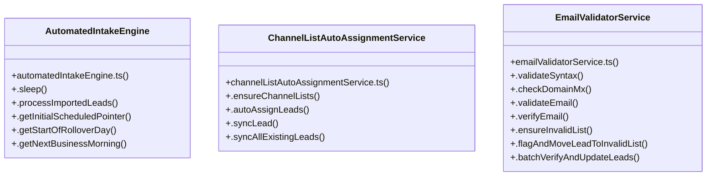

# [handleExecute() & fetchHistory()] Cluster

> 25 nodes · cohesion 0.13

## Key Concepts

- [.processImportedLeads()](file:///Users/ujjawal/Documents/ChatBot/Outreach-Dashboard/server/src/services/automatedIntakeEngine.ts#L35) (16 connections)
- [.autoAssignLeads()](file:///Users/ujjawal/Documents/ChatBot/Outreach-Dashboard/server/src/services/channelListAutoAssignmentService.ts#L83) (9 connections)
- [EmailValidatorService](file:///Users/ujjawal/Documents/ChatBot/Outreach-Dashboard/server/src/services/emailValidatorService.ts#L64) (8 connections)
- [.verifyEmail()](file:///Users/ujjawal/Documents/ChatBot/Outreach-Dashboard/server/src/services/emailValidatorService.ts#L186) (7 connections)
- [AutomatedIntakeEngine](file:///Users/ujjawal/Documents/ChatBot/Outreach-Dashboard/server/src/services/automatedIntakeEngine.ts#L19) (6 connections)
- [.flagAndMoveLeadToInvalidList()](file:///Users/ujjawal/Documents/ChatBot/Outreach-Dashboard/server/src/services/emailValidatorService.ts#L289) (6 connections)
- [ChannelListAutoAssignmentService](file:///Users/ujjawal/Documents/ChatBot/Outreach-Dashboard/server/src/services/channelListAutoAssignmentService.ts#L12) (5 connections)
- [.batchVerifyAndUpdateLeads()](file:///Users/ujjawal/Documents/ChatBot/Outreach-Dashboard/server/src/services/emailValidatorService.ts#L366) (5 connections)
- [.ensureChannelLists()](file:///Users/ujjawal/Documents/ChatBot/Outreach-Dashboard/server/src/services/channelListAutoAssignmentService.ts#L19) (4 connections)
- [.validateSyntax()](file:///Users/ujjawal/Documents/ChatBot/Outreach-Dashboard/server/src/services/emailValidatorService.ts#L72) (4 connections)
- [emailValidatorService.ts](file:///Users/ujjawal/Documents/ChatBot/Outreach-Dashboard/server/src/services/emailValidatorService.ts#L1) (4 connections)
- [.getInitialScheduledPointer()](file:///Users/ujjawal/Documents/ChatBot/Outreach-Dashboard/server/src/services/automatedIntakeEngine.ts#L336) (3 connections)
- [.getStartOfRolloverDay()](file:///Users/ujjawal/Documents/ChatBot/Outreach-Dashboard/server/src/services/automatedIntakeEngine.ts#L367) (3 connections)
- [.checkDomainMx()](file:///Users/ujjawal/Documents/ChatBot/Outreach-Dashboard/server/src/services/emailValidatorService.ts#L129) (3 connections)
- [.getNextBusinessMorning()](file:///Users/ujjawal/Documents/ChatBot/Outreach-Dashboard/server/src/services/automatedIntakeEngine.ts#L377) (2 connections)
- [.syncAllExistingLeads()](file:///Users/ujjawal/Documents/ChatBot/Outreach-Dashboard/server/src/services/channelListAutoAssignmentService.ts#L220) (2 connections)
- [.syncLead()](file:///Users/ujjawal/Documents/ChatBot/Outreach-Dashboard/server/src/services/channelListAutoAssignmentService.ts#L201) (2 connections)
- [.ensureInvalidList()](file:///Users/ujjawal/Documents/ChatBot/Outreach-Dashboard/server/src/services/emailValidatorService.ts#L252) (2 connections)
- [.validateEmail()](file:///Users/ujjawal/Documents/ChatBot/Outreach-Dashboard/server/src/services/emailValidatorService.ts#L179) (2 connections)
- [.sleep()](file:///Users/ujjawal/Documents/ChatBot/Outreach-Dashboard/server/src/services/automatedIntakeEngine.ts#L25) (1 connections)
- [KNOWN_INVALID_USERNAMES](file:///Users/ujjawal/Documents/ChatBot/Outreach-Dashboard/server/src/services/emailValidatorService.ts#L47) (1 connections)
- [KNOWN_PLACEHOLDER_DOMAINS](file:///Users/ujjawal/Documents/ChatBot/Outreach-Dashboard/server/src/services/emailValidatorService.ts#L15) (1 connections)
- [RFC_EMAIL_REGEX](file:///Users/ujjawal/Documents/ChatBot/Outreach-Dashboard/server/src/services/emailValidatorService.ts#L12) (1 connections)
- [automatedIntakeEngine.ts](file:///Users/ujjawal/Documents/ChatBot/Outreach-Dashboard/server/src/services/automatedIntakeEngine.ts#L1) (1 connections)
- [channelListAutoAssignmentService.ts](file:///Users/ujjawal/Documents/ChatBot/Outreach-Dashboard/server/src/services/channelListAutoAssignmentService.ts#L1) (1 connections)

## Class Diagram

## Relationships

- No strong cross-community connections detected

## Source Files

- [/Users/ujjawal/Documents/ChatBot/Outreach-Dashboard/server/src/services/automatedIntakeEngine.ts](file:///Users/ujjawal/Documents/ChatBot/Outreach-Dashboard/server/src/services/automatedIntakeEngine.ts)
- [/Users/ujjawal/Documents/ChatBot/Outreach-Dashboard/server/src/services/channelListAutoAssignmentService.ts](file:///Users/ujjawal/Documents/ChatBot/Outreach-Dashboard/server/src/services/channelListAutoAssignmentService.ts)
- [/Users/ujjawal/Documents/ChatBot/Outreach-Dashboard/server/src/services/emailValidatorService.ts](file:///Users/ujjawal/Documents/ChatBot/Outreach-Dashboard/server/src/services/emailValidatorService.ts)

## Audit Trail

- EXTRACTED: 70 (71%)
- INFERRED: 29 (29%)
- AMBIGUOUS: 0 (0%)

---

*Part of the graphify knowledge wiki. See [[index]] to navigate.*