# [list & EmailSentSyncService] Cluster

> 103 nodes · cohesion 0.03

## Key Concepts

- [test](file:///Users/ujjawal/Documents/ChatBot/Outreach-Dashboard/server/src/routes/inboxes.ts#L60) (55 connections)
- [.sendEmail()](file:///Users/ujjawal/Documents/ChatBot/Outreach-Dashboard/server/src/adapters/emailAdapter.ts#L305) (28 connections)
- [.getEmailCopy()](file:///Users/ujjawal/Documents/ChatBot/Outreach-Dashboard/server/src/services/humanCopywriterService.ts#L226) (19 connections)
- [env.ts](file:///Users/ujjawal/Documents/ChatBot/Outreach-Dashboard/server/src/config/env.ts#L1) (17 connections)
- [GmbScraperService](file:///Users/ujjawal/Documents/ChatBot/Outreach-Dashboard/server/src/services/gmbScraperService.ts#L83) (15 connections)
- [.generateAuditPdf()](file:///Users/ujjawal/Documents/ChatBot/Outreach-Dashboard/server/src/services/technicalAuditPdfService.ts#L668) (14 connections)
- [.hasValidWebsite()](file:///Users/ujjawal/Documents/ChatBot/Outreach-Dashboard/server/src/services/workflowRoutingService.ts#L23) (14 connections)
- [HumanCopywriterService](file:///Users/ujjawal/Documents/ChatBot/Outreach-Dashboard/server/src/services/humanCopywriterService.ts#L35) (12 connections)
- [.importScrapedLeads()](file:///Users/ujjawal/Documents/ChatBot/Outreach-Dashboard/server/src/services/gmbScraperService.ts#L1723) (11 connections)
- [TechnicalAuditPdfService](file:///Users/ujjawal/Documents/ChatBot/Outreach-Dashboard/server/src/services/technicalAuditPdfService.ts#L17) (11 connections)
- [EmailAdapter](file:///Users/ujjawal/Documents/ChatBot/Outreach-Dashboard/server/src/adapters/emailAdapter.ts#L188) (10 connections)
- [.normalizeGmbWebsiteUrl()](file:///Users/ujjawal/Documents/ChatBot/Outreach-Dashboard/server/src/services/gmbScraperService.ts#L334) (10 connections)
- [.scrapeBatchWithCdp()](file:///Users/ujjawal/Documents/ChatBot/Outreach-Dashboard/server/src/services/gmbScraperService.ts#L1020) (10 connections)
- [.searchGmb()](file:///Users/ujjawal/Documents/ChatBot/Outreach-Dashboard/server/src/services/gmbScraperService.ts#L482) (8 connections)
- [.processInboundMessage()](file:///Users/ujjawal/Documents/ChatBot/Outreach-Dashboard/server/src/services/autonomousInboundAgent.ts#L43) (7 connections)
- [runQA()](file:///Users/ujjawal/Documents/ChatBot/Outreach-Dashboard/scratch/run_full_qa.ts#L44) (7 connections)
- [WorkflowRoutingService](file:///Users/ujjawal/Documents/ChatBot/Outreach-Dashboard/server/src/services/workflowRoutingService.ts#L19) (7 connections)
- [.verifyWebsiteLive()](file:///Users/ujjawal/Documents/ChatBot/Outreach-Dashboard/server/src/services/gmbScraperService.ts#L394) (6 connections)
- [ensurePhoneWithCountryCode()](file:///Users/ujjawal/Documents/ChatBot/Outreach-Dashboard/server/src/utils/phoneCountryCode.ts#L39) (6 connections)
- [.analyzeAudit()](file:///Users/ujjawal/Documents/ChatBot/Outreach-Dashboard/server/src/services/serviceRecommendationEngine.ts#L85) (6 connections)
- [.buildAuditHtml()](file:///Users/ujjawal/Documents/ChatBot/Outreach-Dashboard/server/src/services/technicalAuditPdfService.ts#L270) (6 connections)
- [buildHumanoidHtml()](file:///Users/ujjawal/Documents/ChatBot/Outreach-Dashboard/server/src/adapters/emailAdapter.ts#L57) (5 connections)
- [.buildGreeting()](file:///Users/ujjawal/Documents/ChatBot/Outreach-Dashboard/server/src/services/humanCopywriterService.ts#L95) (5 connections)
- [.validateAuditPdf()](file:///Users/ujjawal/Documents/ChatBot/Outreach-Dashboard/server/src/services/workflowRoutingService.ts#L130) (5 connections)
- [.cleanBizName()](file:///Users/ujjawal/Documents/ChatBot/Outreach-Dashboard/server/src/services/gmbScraperService.ts#L1711) (4 connections)
- *... and 78 more nodes in this community*

## Class Diagram

```mermaid
classDiagram
    class AutonomousInboundAgent {
        +autonomousInboundAgent.ts()
        +.getSettings()
        +.processInboundMessage()
    }
    class EmailAdapter {
        +emailAdapter.ts()
        +.setMockMode()
        +.isTestDatabase()
        +.isMock()
        +.getMockSentLog()
        +.clearMockSentLog()
        +.getWarmupStatus()
        +.setSubdomain()
        +.setWarmupStage()
        +.sendEmail()
    }
    class GmbScraperService {
        +gmbScraperService.ts()
        +.getChromeExecutable()
        +.ensureChromeInstalled()
        +.getFreePort()
        +.waitForCdpReady()
        +.normalizeGmbWebsiteUrl()
        +.verifyWebsiteLive()
        +.searchGmb()
        +.parseTbmMapResponse()
        +.scrapeBatchWithCdp()
    }
    class HumanCopywriterService {
        +humanCopywriterService.ts()
        +.cleanBusinessName()
        +.cleanLocation()
        +.cleanCategory()
        +.buildGreeting()
        +.buildSalutation()
        +.pick()
        +.getPostalAddress()
        +.buildFooter()
        +.compose()
    }
    class ServiceRecommendationEngine {
        +serviceRecommendationEngine.ts()
        +.analyzeAudit()
    }
    class TechnicalAuditPdfService {
        +technicalAuditPdfService.ts()
        +.constructor()
        +.getChromeExecutable()
        +.sanitizeFilename()
        +.escapeHtml()
        +.translateFindingForClient()
        +.buildClientActionPlan()
        +.buildAuditHtml()
        +.generateAuditPdf()
        +.ensurePdfForLead()
    }
    class WorkflowRoutingService {
        +workflowRoutingService.ts()
        +.hasValidWebsite()
        +.cleanWebsiteUrl()
        +.determineWorkflow()
        +.validateAuditPdf()
        +.sanitizeTokens()
        +.verifyCompliance()
    }
```

## Relationships

- No strong cross-community connections detected

## Source Files

- [/Users/ujjawal/Documents/ChatBot/Outreach-Dashboard/scratch/run_full_qa.ts](file:///Users/ujjawal/Documents/ChatBot/Outreach-Dashboard/scratch/run_full_qa.ts)
- [/Users/ujjawal/Documents/ChatBot/Outreach-Dashboard/server/src/adapters/emailAdapter.ts](file:///Users/ujjawal/Documents/ChatBot/Outreach-Dashboard/server/src/adapters/emailAdapter.ts)
- [/Users/ujjawal/Documents/ChatBot/Outreach-Dashboard/server/src/config/env.ts](file:///Users/ujjawal/Documents/ChatBot/Outreach-Dashboard/server/src/config/env.ts)
- [/Users/ujjawal/Documents/ChatBot/Outreach-Dashboard/server/src/db/add_website_and_country.ts](file:///Users/ujjawal/Documents/ChatBot/Outreach-Dashboard/server/src/db/add_website_and_country.ts)
- [/Users/ujjawal/Documents/ChatBot/Outreach-Dashboard/server/src/routes/inboxes.ts](file:///Users/ujjawal/Documents/ChatBot/Outreach-Dashboard/server/src/routes/inboxes.ts)
- [/Users/ujjawal/Documents/ChatBot/Outreach-Dashboard/server/src/routes/leads.ts](file:///Users/ujjawal/Documents/ChatBot/Outreach-Dashboard/server/src/routes/leads.ts)
- [/Users/ujjawal/Documents/ChatBot/Outreach-Dashboard/server/src/services/autonomousInboundAgent.ts](file:///Users/ujjawal/Documents/ChatBot/Outreach-Dashboard/server/src/services/autonomousInboundAgent.ts)
- [/Users/ujjawal/Documents/ChatBot/Outreach-Dashboard/server/src/services/dealCalculationService.ts](file:///Users/ujjawal/Documents/ChatBot/Outreach-Dashboard/server/src/services/dealCalculationService.ts)
- [/Users/ujjawal/Documents/ChatBot/Outreach-Dashboard/server/src/services/gmbScraperService.ts](file:///Users/ujjawal/Documents/ChatBot/Outreach-Dashboard/server/src/services/gmbScraperService.ts)
- [/Users/ujjawal/Documents/ChatBot/Outreach-Dashboard/server/src/services/humanCopywriterService.ts](file:///Users/ujjawal/Documents/ChatBot/Outreach-Dashboard/server/src/services/humanCopywriterService.ts)
- [/Users/ujjawal/Documents/ChatBot/Outreach-Dashboard/server/src/services/serviceRecommendationEngine.ts](file:///Users/ujjawal/Documents/ChatBot/Outreach-Dashboard/server/src/services/serviceRecommendationEngine.ts)
- [/Users/ujjawal/Documents/ChatBot/Outreach-Dashboard/server/src/services/technicalAuditPdfService.ts](file:///Users/ujjawal/Documents/ChatBot/Outreach-Dashboard/server/src/services/technicalAuditPdfService.ts)
- [/Users/ujjawal/Documents/ChatBot/Outreach-Dashboard/server/src/services/workflowRoutingService.ts](file:///Users/ujjawal/Documents/ChatBot/Outreach-Dashboard/server/src/services/workflowRoutingService.ts)
- [/Users/ujjawal/Documents/ChatBot/Outreach-Dashboard/server/src/utils/phoneCountryCode.ts](file:///Users/ujjawal/Documents/ChatBot/Outreach-Dashboard/server/src/utils/phoneCountryCode.ts)
- [/Users/ujjawal/Documents/ChatBot/Outreach-Dashboard/server/src/utils/smtpClassifier.ts](file:///Users/ujjawal/Documents/ChatBot/Outreach-Dashboard/server/src/utils/smtpClassifier.ts)
- [/Users/ujjawal/Documents/ChatBot/Outreach-Dashboard/src/pages/LeadScraperPage.tsx](file:///Users/ujjawal/Documents/ChatBot/Outreach-Dashboard/src/pages/LeadScraperPage.tsx)
- [/Users/ujjawal/Documents/ChatBot/Outreach-Dashboard/tests/htmlEscape.test.ts](file:///Users/ujjawal/Documents/ChatBot/Outreach-Dashboard/tests/htmlEscape.test.ts)

## Audit Trail

- EXTRACTED: 267 (59%)
- INFERRED: 189 (41%)
- AMBIGUOUS: 0 (0%)

---

*Part of the graphify knowledge wiki. See [[index]] to navigate.*