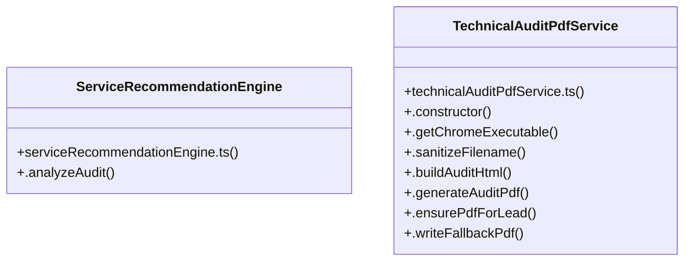

# [list & EmailSentSyncService] Cluster

> 115 nodes · cohesion 0.02

## Key Concepts

- [LeadScraperPage.tsx](file:///Users/ujjawal/Documents/ChatBot/Outreach-Dashboard/src/pages/LeadScraperPage.tsx#L1) (72 connections)
- [map](file:///Users/ujjawal/Documents/ChatBot/Outreach-Dashboard/src/pages/CrmPage.tsx#L679) (47 connections)
- [parseImport.ts](file:///Users/ujjawal/Documents/ChatBot/Outreach-Dashboard/src/utils/parseImport.ts#L1) (11 connections)
- [.generateAuditPdf()](file:///Users/ujjawal/Documents/ChatBot/Outreach-Dashboard/server/src/services/technicalAuditPdfService.ts#L392) (10 connections)
- [parseImport()](file:///Users/ujjawal/Documents/ChatBot/Outreach-Dashboard/src/utils/parseImport.ts#L96) (8 connections)
- [TechnicalAuditPdfService](file:///Users/ujjawal/Documents/ChatBot/Outreach-Dashboard/server/src/services/technicalAuditPdfService.ts#L16) (8 connections)
- [markDuplicates()](file:///Users/ujjawal/Documents/ChatBot/Outreach-Dashboard/src/utils/parseImport.ts#L237) (7 connections)
- [mockData.ts](file:///Users/ujjawal/Documents/ChatBot/Outreach-Dashboard/src/mockData.ts#L1) (7 connections)
- [.ensurePdfForLead()](file:///Users/ujjawal/Documents/ChatBot/Outreach-Dashboard/server/src/services/technicalAuditPdfService.ts#L459) (6 connections)
- [runCsvTests()](file:///Users/ujjawal/Documents/ChatBot/Outreach-Dashboard/tests/csv-import.test.ts#L4) (5 connections)
- [.analyzeAudit()](file:///Users/ujjawal/Documents/ChatBot/Outreach-Dashboard/server/src/services/serviceRecommendationEngine.ts#L85) (4 connections)
- [analyzeSoakLogFile()](file:///Users/ujjawal/Documents/ChatBot/Outreach-Dashboard/server/src/scripts/analyzeSoakLog.ts#L35) (3 connections)
- [uid()](file:///Users/ujjawal/Documents/ChatBot/Outreach-Dashboard/src/mockData.ts#L10) (3 connections)
- [sanitizeCsvFormula()](file:///Users/ujjawal/Documents/ChatBot/Outreach-Dashboard/src/utils/parseImport.ts#L47) (3 connections)
- [.buildAuditHtml()](file:///Users/ujjawal/Documents/ChatBot/Outreach-Dashboard/server/src/services/technicalAuditPdfService.ts#L75) (3 connections)
- [.writeFallbackPdf()](file:///Users/ujjawal/Documents/ChatBot/Outreach-Dashboard/server/src/services/technicalAuditPdfService.ts#L539) (3 connections)
- [analyzeSoakLog.ts](file:///Users/ujjawal/Documents/ChatBot/Outreach-Dashboard/server/src/scripts/analyzeSoakLog.ts#L1) (3 connections)
- [serviceRecommendationEngine.ts](file:///Users/ujjawal/Documents/ChatBot/Outreach-Dashboard/server/src/services/serviceRecommendationEngine.ts#L1) (3 connections)
- [loadExtraHistory()](file:///Users/ujjawal/Documents/ChatBot/Outreach-Dashboard/src/components/InboundRepliesModal.tsx#L555) (2 connections)
- [handleAddBulkLocations()](file:///Users/ujjawal/Documents/ChatBot/Outreach-Dashboard/src/pages/LeadScraperPage.tsx#L418) (2 connections)
- [handleExportCsv()](file:///Users/ujjawal/Documents/ChatBot/Outreach-Dashboard/src/pages/LeadScraperPage.tsx#L674) (2 connections)
- [handleSelectAll()](file:///Users/ujjawal/Documents/ChatBot/Outreach-Dashboard/src/pages/LeadScraperPage.tsx#L612) (2 connections)
- [handleStartScrape()](file:///Users/ujjawal/Documents/ChatBot/Outreach-Dashboard/src/pages/LeadScraperPage.tsx#L497) (2 connections)
- [extractPhoneKeys()](file:///Users/ujjawal/Documents/ChatBot/Outreach-Dashboard/src/utils/parseImport.ts#L30) (2 connections)
- [markIncomplete()](file:///Users/ujjawal/Documents/ChatBot/Outreach-Dashboard/src/utils/parseImport.ts#L316) (2 connections)
- *... and 90 more nodes in this community*

## Class Diagram

## Relationships

- No strong cross-community connections detected

## Source Files

- [/Users/ujjawal/Documents/ChatBot/Outreach-Dashboard/server/src/scripts/analyzeSoakLog.ts](file:///Users/ujjawal/Documents/ChatBot/Outreach-Dashboard/server/src/scripts/analyzeSoakLog.ts)
- [/Users/ujjawal/Documents/ChatBot/Outreach-Dashboard/server/src/services/serviceRecommendationEngine.ts](file:///Users/ujjawal/Documents/ChatBot/Outreach-Dashboard/server/src/services/serviceRecommendationEngine.ts)
- [/Users/ujjawal/Documents/ChatBot/Outreach-Dashboard/server/src/services/technicalAuditPdfService.ts](file:///Users/ujjawal/Documents/ChatBot/Outreach-Dashboard/server/src/services/technicalAuditPdfService.ts)
- [/Users/ujjawal/Documents/ChatBot/Outreach-Dashboard/src/components/InboundRepliesModal.tsx](file:///Users/ujjawal/Documents/ChatBot/Outreach-Dashboard/src/components/InboundRepliesModal.tsx)
- [/Users/ujjawal/Documents/ChatBot/Outreach-Dashboard/src/components/ScheduleListModal.tsx](file:///Users/ujjawal/Documents/ChatBot/Outreach-Dashboard/src/components/ScheduleListModal.tsx)
- [/Users/ujjawal/Documents/ChatBot/Outreach-Dashboard/src/mockData.ts](file:///Users/ujjawal/Documents/ChatBot/Outreach-Dashboard/src/mockData.ts)
- [/Users/ujjawal/Documents/ChatBot/Outreach-Dashboard/src/pages/CrmPage.tsx](file:///Users/ujjawal/Documents/ChatBot/Outreach-Dashboard/src/pages/CrmPage.tsx)
- [/Users/ujjawal/Documents/ChatBot/Outreach-Dashboard/src/pages/LeadScraperPage.tsx](file:///Users/ujjawal/Documents/ChatBot/Outreach-Dashboard/src/pages/LeadScraperPage.tsx)
- [/Users/ujjawal/Documents/ChatBot/Outreach-Dashboard/src/utils/parseImport.ts](file:///Users/ujjawal/Documents/ChatBot/Outreach-Dashboard/src/utils/parseImport.ts)
- [/Users/ujjawal/Documents/ChatBot/Outreach-Dashboard/tests/csv-import.test.ts](file:///Users/ujjawal/Documents/ChatBot/Outreach-Dashboard/tests/csv-import.test.ts)

## Audit Trail

- EXTRACTED: 236 (74%)
- INFERRED: 83 (26%)
- AMBIGUOUS: 0 (0%)

---

*Part of the graphify knowledge wiki. See [[index]] to navigate.*