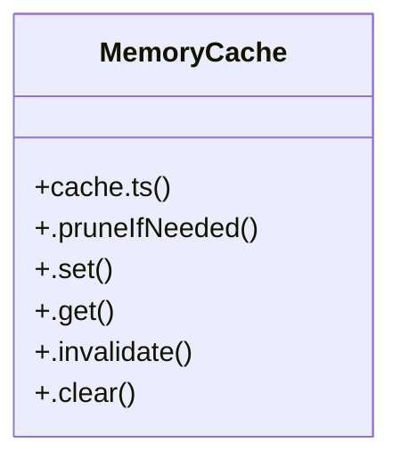

# [loadPipeline() & handleMarkLost()] Cluster

> 62 nodes · cohesion 0.04

## Key Concepts

- [AutopilotControlModal.tsx](file:///Users/ujjawal/Documents/ChatBot/Outreach-Dashboard/src/components/AutopilotControlModal.tsx#L1) (22 connections)
- [clients.ts](file:///Users/ujjawal/Documents/ChatBot/Outreach-Dashboard/server/src/routes/clients.ts#L1) (17 connections)
- [auth.ts](file:///Users/ujjawal/Documents/ChatBot/Outreach-Dashboard/server/src/middleware/auth.ts#L1) (13 connections)
- [next](file:///Users/ujjawal/Documents/ChatBot/Outreach-Dashboard/src/pages/CrmPage.tsx#L1624) (8 connections)
- [requireAuth()](file:///Users/ujjawal/Documents/ChatBot/Outreach-Dashboard/server/src/middleware/auth.ts#L199) (7 connections)
- [MemoryCache](file:///Users/ujjawal/Documents/ChatBot/Outreach-Dashboard/server/src/config/cache.ts#L6) (6 connections)
- [status](file:///Users/ujjawal/Documents/ChatBot/Outreach-Dashboard/src/components/AutopilotControlModal.tsx#L38) (5 connections)
- [pruneRevokedSignatures()](file:///Users/ujjawal/Documents/ChatBot/Outreach-Dashboard/server/src/middleware/auth.ts#L13) (3 connections)
- [revokeToken()](file:///Users/ujjawal/Documents/ChatBot/Outreach-Dashboard/server/src/middleware/auth.ts#L29) (3 connections)
- [.pruneIfNeeded()](file:///Users/ujjawal/Documents/ChatBot/Outreach-Dashboard/server/src/config/cache.ts#L13) (3 connections)
- [handleUpdateClient()](file:///Users/ujjawal/Documents/ChatBot/Outreach-Dashboard/server/src/routes/clients.ts#L135) (3 connections)
- [setIdempotencyEntry()](file:///Users/ujjawal/Documents/ChatBot/Outreach-Dashboard/server/src/routes/conversations.ts#L11) (3 connections)
- [extractToken()](file:///Users/ujjawal/Documents/ChatBot/Outreach-Dashboard/server/src/middleware/auth.ts#L160) (2 connections)
- [isAuthBypassed()](file:///Users/ujjawal/Documents/ChatBot/Outreach-Dashboard/server/src/middleware/auth.ts#L189) (2 connections)
- [isTokenRevoked()](file:///Users/ujjawal/Documents/ChatBot/Outreach-Dashboard/server/src/middleware/auth.ts#L49) (2 connections)
- [verifyScopedPdfToken()](file:///Users/ujjawal/Documents/ChatBot/Outreach-Dashboard/server/src/middleware/auth.ts#L138) (2 connections)
- [verifySessionToken()](file:///Users/ujjawal/Documents/ChatBot/Outreach-Dashboard/server/src/middleware/auth.ts#L88) (2 connections)
- [cache.ts](file:///Users/ujjawal/Documents/ChatBot/Outreach-Dashboard/server/src/config/cache.ts#L1) (2 connections)
- [generateScopedPdfToken()](file:///Users/ujjawal/Documents/ChatBot/Outreach-Dashboard/server/src/middleware/auth.ts#L127) (1 connections)
- [generateSessionToken()](file:///Users/ujjawal/Documents/ChatBot/Outreach-Dashboard/server/src/middleware/auth.ts#L65) (1 connections)
- [MAX_REVOKED_ENTRIES](file:///Users/ujjawal/Documents/ChatBot/Outreach-Dashboard/server/src/middleware/auth.ts#L8) (1 connections)
- [revokedSignatures](file:///Users/ujjawal/Documents/ChatBot/Outreach-Dashboard/server/src/middleware/auth.ts#L11) (1 connections)
- [TOKEN_EXPIRY_HOURS](file:///Users/ujjawal/Documents/ChatBot/Outreach-Dashboard/server/src/middleware/auth.ts#L7) (1 connections)
- [[activeTab, setActiveTab]](file:///Users/ujjawal/Documents/ChatBot/Outreach-Dashboard/src/components/AutopilotControlModal.tsx#L32) (1 connections)
- [[autoConvert, setAutoConvert]](file:///Users/ujjawal/Documents/ChatBot/Outreach-Dashboard/src/components/AutopilotControlModal.tsx#L46) (1 connections)
- *... and 37 more nodes in this community*

## Class Diagram

## Relationships

- No strong cross-community connections detected

## Source Files

- [/Users/ujjawal/Documents/ChatBot/Outreach-Dashboard/server/src/config/cache.ts](file:///Users/ujjawal/Documents/ChatBot/Outreach-Dashboard/server/src/config/cache.ts)
- [/Users/ujjawal/Documents/ChatBot/Outreach-Dashboard/server/src/middleware/auth.ts](file:///Users/ujjawal/Documents/ChatBot/Outreach-Dashboard/server/src/middleware/auth.ts)
- [/Users/ujjawal/Documents/ChatBot/Outreach-Dashboard/server/src/routes/clients.ts](file:///Users/ujjawal/Documents/ChatBot/Outreach-Dashboard/server/src/routes/clients.ts)
- [/Users/ujjawal/Documents/ChatBot/Outreach-Dashboard/server/src/routes/conversations.ts](file:///Users/ujjawal/Documents/ChatBot/Outreach-Dashboard/server/src/routes/conversations.ts)
- [/Users/ujjawal/Documents/ChatBot/Outreach-Dashboard/src/components/AutopilotControlModal.tsx](file:///Users/ujjawal/Documents/ChatBot/Outreach-Dashboard/src/components/AutopilotControlModal.tsx)
- [/Users/ujjawal/Documents/ChatBot/Outreach-Dashboard/src/pages/CrmPage.tsx](file:///Users/ujjawal/Documents/ChatBot/Outreach-Dashboard/src/pages/CrmPage.tsx)

## Audit Trail

- EXTRACTED: 128 (86%)
- INFERRED: 21 (14%)
- AMBIGUOUS: 0 (0%)

---

*Part of the graphify knowledge wiki. See [[index]] to navigate.*