# [map & FiveSlotSenderService] Cluster

> 117 nodes · cohesion 0.03

## Key Concepts

- [test](file:///Users/ujjawal/Documents/ChatBot/Outreach-Dashboard/server/src/routes/inboxes.ts#L56) (44 connections)
- [.get()](file:///Users/ujjawal/Documents/ChatBot/Outreach-Dashboard/server/src/config/cache.ts#L22) (29 connections)
- [env.ts](file:///Users/ujjawal/Documents/ChatBot/Outreach-Dashboard/server/src/config/env.ts#L1) (17 connections)
- [api.ts](file:///Users/ujjawal/Documents/ChatBot/Outreach-Dashboard/src/services/api.ts#L1) (12 connections)
- [text](file:///Users/ujjawal/Documents/ChatBot/Outreach-Dashboard/src/pages/CrmPage.tsx#L1999) (11 connections)
- [MultiModelOrchestrator](file:///Users/ujjawal/Documents/ChatBot/Outreach-Dashboard/server/src/services/multiModelOrchestrator.ts#L62) (11 connections)
- [.executeCommand()](file:///Users/ujjawal/Documents/ChatBot/Outreach-Dashboard/server/src/services/aiCommandService.ts#L430) (10 connections)
- [ClientAuditIntelligenceService](file:///Users/ujjawal/Documents/ChatBot/Outreach-Dashboard/server/src/services/clientAuditIntelligenceService.ts#L119) (10 connections)
- [.executeFunctionality()](file:///Users/ujjawal/Documents/ChatBot/Outreach-Dashboard/server/src/services/multiModelOrchestrator.ts#L357) (10 connections)
- [.runEnrichmentCycle()](file:///Users/ujjawal/Documents/ChatBot/Outreach-Dashboard/server/src/services/autonomousLeadEnricher.ts#L137) (9 connections)
- [.auditWebsite()](file:///Users/ujjawal/Documents/ChatBot/Outreach-Dashboard/server/src/services/clientAuditIntelligenceService.ts#L214) (9 connections)
- [GoogleEnrichmentService](file:///Users/ujjawal/Documents/ChatBot/Outreach-Dashboard/server/src/services/googleEnrichmentService.ts#L34) (9 connections)
- [WebsiteFormService](file:///Users/ujjawal/Documents/ChatBot/Outreach-Dashboard/server/src/services/websiteFormService.ts#L40) (9 connections)
- [.evaluate()](file:///Users/ujjawal/Documents/ChatBot/Outreach-Dashboard/server/src/services/whatsappValidator.ts#L22) (9 connections)
- [.fetchGoogleProfile()](file:///Users/ujjawal/Documents/ChatBot/Outreach-Dashboard/server/src/services/googleEnrichmentService.ts#L66) (8 connections)
- [.submitContactForm()](file:///Users/ujjawal/Documents/ChatBot/Outreach-Dashboard/server/src/services/websiteFormService.ts#L400) (8 connections)
- [cleanSiteUrl()](file:///Users/ujjawal/Documents/ChatBot/Outreach-Dashboard/src/services/api.ts#L62) (7 connections)
- [.syncFromGoogleMaps()](file:///Users/ujjawal/Documents/ChatBot/Outreach-Dashboard/server/src/services/googleEnrichmentService.ts#L265) (7 connections)
- [LeadScraperService](file:///Users/ujjawal/Documents/ChatBot/Outreach-Dashboard/server/src/services/leadScraperService.ts#L206) (7 connections)
- [.detectAndSaveFormForLead()](file:///Users/ujjawal/Documents/ChatBot/Outreach-Dashboard/server/src/services/websiteFormService.ts#L305) (7 connections)
- [AutonomousLeadEnricher](file:///Users/ujjawal/Documents/ChatBot/Outreach-Dashboard/server/src/services/autonomousLeadEnricher.ts#L20) (6 connections)
- [.normalizeAuditUrl()](file:///Users/ujjawal/Documents/ChatBot/Outreach-Dashboard/server/src/services/clientAuditIntelligenceService.ts#L136) (6 connections)
- [.runLocalAudit()](file:///Users/ujjawal/Documents/ChatBot/Outreach-Dashboard/server/src/services/clientAuditIntelligenceService.ts#L491) (6 connections)
- [.enrichLead()](file:///Users/ujjawal/Documents/ChatBot/Outreach-Dashboard/server/src/services/googleEnrichmentService.ts#L396) (6 connections)
- [.scrapePlace()](file:///Users/ujjawal/Documents/ChatBot/Outreach-Dashboard/server/src/services/googleMapsScraper.ts#L24) (6 connections)
- *... and 92 more nodes in this community*

## Class Diagram

```mermaid
classDiagram
    class AutonomousLeadEnricher {
        +autonomousLeadEnricher.ts()
        +.sleep()
        +.fetchPage()
        +.extractEmailsFromHtml()
        +.extractSocialsFromHtml()
        +.runEnrichmentCycle()
    }
    class ClientAuditIntelligenceService {
        +clientAuditIntelligenceService.ts()
        +.cleanUrl()
        +.normalizeAuditUrl()
        +.extractDomain()
        +.auditWebsite()
        +.normalizeRemoteAuditData()
        +.runLocalAudit()
        +.mapOdsSolution()
        +.dispatchToLodWebhook()
        +.generatePitchForLead()
    }
    class GoogleEnrichmentService {
        +googleEnrichmentService.ts()
        +.inferCategory()
        +.fetchGoogleProfile()
        +.syncFromGoogleMaps()
        +.enrichLead()
        +.batchEnrichLeads()
        +.syncAllLeadsWithGmb()
        +.start12HourGmbSync()
        +.getGmbSyncStatus()
    }
    class GoogleMapsScraper {
        +googleMapsScraper.ts()
        +.scrapePlace()
        +.normalizeUrl()
        +.scrapeWithHeadlessChrome()
        +.scrapeWithHttpFallback()
    }
    class LeadScraperService {
        +leadScraperService.ts()
        +.getStatus()
        +.stopGradualScrape()
        +.crawlSiteForAddress()
        +.scrapeLeadDetails()
        +.scrapeSingleLead()
        +.startGradualLocationScrape()
    }
    class MultiModelOrchestrator {
        +multiModelOrchestrator.ts()
        +.constructor()
        +.initialize10Models()
        +.checkRateLimit()
        +.recordRateLimit()
        +.recordSuccess()
        +.getNextAvailableModel()
        +.getModelsStatus()
        +.executeFunctionality()
        +.dispatchFunctionality()
    }
    class WebsiteFormService {
        +websiteFormService.ts()
        +.normalizeUrl()
        +.getOrigin()
        +.resolveLeadWebsite()
        +.fetchHtml()
        +.parseFormFromHtml()
        +.detectContactForm()
        +.detectAndSaveFormForLead()
        +.submitContactForm()
    }
```

## Relationships

- No strong cross-community connections detected

## Source Files

- [/Users/ujjawal/Documents/ChatBot/Outreach-Dashboard/server/src/config/cache.ts](file:///Users/ujjawal/Documents/ChatBot/Outreach-Dashboard/server/src/config/cache.ts)
- [/Users/ujjawal/Documents/ChatBot/Outreach-Dashboard/server/src/config/env.ts](file:///Users/ujjawal/Documents/ChatBot/Outreach-Dashboard/server/src/config/env.ts)
- [/Users/ujjawal/Documents/ChatBot/Outreach-Dashboard/server/src/db/add_website_and_country.ts](file:///Users/ujjawal/Documents/ChatBot/Outreach-Dashboard/server/src/db/add_website_and_country.ts)
- [/Users/ujjawal/Documents/ChatBot/Outreach-Dashboard/server/src/routes/inboxes.ts](file:///Users/ujjawal/Documents/ChatBot/Outreach-Dashboard/server/src/routes/inboxes.ts)
- [/Users/ujjawal/Documents/ChatBot/Outreach-Dashboard/server/src/routes/leads.ts](file:///Users/ujjawal/Documents/ChatBot/Outreach-Dashboard/server/src/routes/leads.ts)
- [/Users/ujjawal/Documents/ChatBot/Outreach-Dashboard/server/src/services/aiCommandService.ts](file:///Users/ujjawal/Documents/ChatBot/Outreach-Dashboard/server/src/services/aiCommandService.ts)
- [/Users/ujjawal/Documents/ChatBot/Outreach-Dashboard/server/src/services/autonomousLeadEnricher.ts](file:///Users/ujjawal/Documents/ChatBot/Outreach-Dashboard/server/src/services/autonomousLeadEnricher.ts)
- [/Users/ujjawal/Documents/ChatBot/Outreach-Dashboard/server/src/services/clientAuditIntelligenceService.ts](file:///Users/ujjawal/Documents/ChatBot/Outreach-Dashboard/server/src/services/clientAuditIntelligenceService.ts)
- [/Users/ujjawal/Documents/ChatBot/Outreach-Dashboard/server/src/services/dealCalculationService.ts](file:///Users/ujjawal/Documents/ChatBot/Outreach-Dashboard/server/src/services/dealCalculationService.ts)
- [/Users/ujjawal/Documents/ChatBot/Outreach-Dashboard/server/src/services/fiveSlotSenderService.ts](file:///Users/ujjawal/Documents/ChatBot/Outreach-Dashboard/server/src/services/fiveSlotSenderService.ts)
- [/Users/ujjawal/Documents/ChatBot/Outreach-Dashboard/server/src/services/gmbScraperService.ts](file:///Users/ujjawal/Documents/ChatBot/Outreach-Dashboard/server/src/services/gmbScraperService.ts)
- [/Users/ujjawal/Documents/ChatBot/Outreach-Dashboard/server/src/services/googleEnrichmentService.ts](file:///Users/ujjawal/Documents/ChatBot/Outreach-Dashboard/server/src/services/googleEnrichmentService.ts)
- [/Users/ujjawal/Documents/ChatBot/Outreach-Dashboard/server/src/services/googleMapsScraper.ts](file:///Users/ujjawal/Documents/ChatBot/Outreach-Dashboard/server/src/services/googleMapsScraper.ts)
- [/Users/ujjawal/Documents/ChatBot/Outreach-Dashboard/server/src/services/leadScraperService.ts](file:///Users/ujjawal/Documents/ChatBot/Outreach-Dashboard/server/src/services/leadScraperService.ts)
- [/Users/ujjawal/Documents/ChatBot/Outreach-Dashboard/server/src/services/multiModelOrchestrator.ts](file:///Users/ujjawal/Documents/ChatBot/Outreach-Dashboard/server/src/services/multiModelOrchestrator.ts)
- [/Users/ujjawal/Documents/ChatBot/Outreach-Dashboard/server/src/services/websiteFormService.ts](file:///Users/ujjawal/Documents/ChatBot/Outreach-Dashboard/server/src/services/websiteFormService.ts)
- [/Users/ujjawal/Documents/ChatBot/Outreach-Dashboard/server/src/services/whatsappValidator.ts](file:///Users/ujjawal/Documents/ChatBot/Outreach-Dashboard/server/src/services/whatsappValidator.ts)
- [/Users/ujjawal/Documents/ChatBot/Outreach-Dashboard/src/pages/CrmPage.tsx](file:///Users/ujjawal/Documents/ChatBot/Outreach-Dashboard/src/pages/CrmPage.tsx)
- [/Users/ujjawal/Documents/ChatBot/Outreach-Dashboard/src/services/api.ts](file:///Users/ujjawal/Documents/ChatBot/Outreach-Dashboard/src/services/api.ts)
- [/Users/ujjawal/Documents/ChatBot/Outreach-Dashboard/tests/cors-csrf.test.ts](file:///Users/ujjawal/Documents/ChatBot/Outreach-Dashboard/tests/cors-csrf.test.ts)

## Audit Trail

- EXTRACTED: 297 (62%)
- INFERRED: 179 (38%)
- AMBIGUOUS: 0 (0%)

---

*Part of the graphify knowledge wiki. See [[index]] to navigate.*