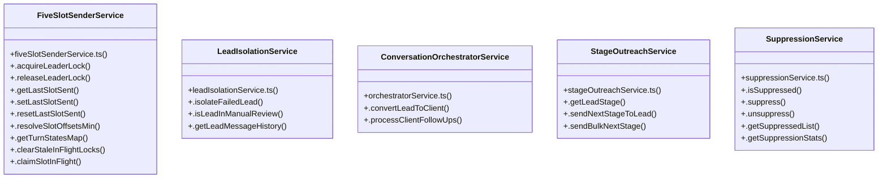

# [query() & LinkedInService] Cluster

> 203 nodes · cohesion 0.02

## Key Concepts

- [query()](file:///Users/ujjawal/Documents/ChatBot/Outreach-Dashboard/server/src/config/db.ts#L43) (114 connections)
- [map](file:///Users/ujjawal/Documents/ChatBot/Outreach-Dashboard/src/pages/CrmPage.tsx#L945) (54 connections)
- [FiveSlotSenderService](file:///Users/ujjawal/Documents/ChatBot/Outreach-Dashboard/server/src/services/fiveSlotSenderService.ts#L155) (50 connections)
- [.processGlobalTick()](file:///Users/ujjawal/Documents/ChatBot/Outreach-Dashboard/server/src/services/fiveSlotSenderService.ts#L2116) (43 connections)
- [.sendNextStageToLead()](file:///Users/ujjawal/Documents/ChatBot/Outreach-Dashboard/server/src/services/stageOutreachService.ts#L226) (30 connections)
- [.set()](file:///Users/ujjawal/Documents/ChatBot/Outreach-Dashboard/server/src/config/cache.ts#L29) (27 connections)
- [.triggerAuditForLead()](file:///Users/ujjawal/Documents/ChatBot/Outreach-Dashboard/server/src/services/fiveSlotSenderService.ts#L1751) (20 connections)
- [logPipeline()](file:///Users/ujjawal/Documents/ChatBot/Outreach-Dashboard/server/src/utils/pipelineLogger.ts#L67) (20 connections)
- [.getSettings()](file:///Users/ujjawal/Documents/ChatBot/Outreach-Dashboard/server/src/services/fiveSlotSenderService.ts#L577) (18 connections)
- [runSeniorQA()](file:///Users/ujjawal/Documents/ChatBot/Outreach-Dashboard/scratch/qa_senior_email_scheduler.ts#L75) (18 connections)
- [.updateSettings()](file:///Users/ujjawal/Documents/ChatBot/Outreach-Dashboard/server/src/services/fiveSlotSenderService.ts#L845) (15 connections)
- [logPipelineError()](file:///Users/ujjawal/Documents/ChatBot/Outreach-Dashboard/server/src/utils/pipelineLogger.ts#L169) (15 connections)
- [main()](file:///Users/ujjawal/Documents/ChatBot/Outreach-Dashboard/server/src/scripts/testB23Organic100Leads.ts#L11) (15 connections)
- [main()](file:///Users/ujjawal/Documents/ChatBot/Outreach-Dashboard/server/src/scripts/soak3HourGridTest.ts#L15) (14 connections)
- [.scheduleListDispatch()](file:///Users/ujjawal/Documents/ChatBot/Outreach-Dashboard/server/src/services/emailSchedulerService.ts#L604) (13 connections)
- [.ensureLeadAuditReady()](file:///Users/ujjawal/Documents/ChatBot/Outreach-Dashboard/server/src/services/fiveSlotSenderService.ts#L1517) (13 connections)
- [.getSlotsStatus()](file:///Users/ujjawal/Documents/ChatBot/Outreach-Dashboard/server/src/services/fiveSlotSenderService.ts#L3253) (13 connections)
- [main()](file:///Users/ujjawal/Documents/ChatBot/Outreach-Dashboard/server/src/scripts/testItem10EmailAndUnsubscribe.ts#L10) (13 connections)
- [db.ts](file:///Users/ujjawal/Documents/ChatBot/Outreach-Dashboard/server/src/config/db.ts#L1) (13 connections)
- [.isolateFailedLead()](file:///Users/ujjawal/Documents/ChatBot/Outreach-Dashboard/server/src/services/leadIsolationService.ts#L23) (12 connections)
- [.autoAssignUnassignedLeads()](file:///Users/ujjawal/Documents/ChatBot/Outreach-Dashboard/server/src/services/fiveSlotSenderService.ts#L1174) (11 connections)
- [.handleDispatchFailure()](file:///Users/ujjawal/Documents/ChatBot/Outreach-Dashboard/server/src/services/fiveSlotSenderService.ts#L2944) (11 connections)
- [.isSuppressed()](file:///Users/ujjawal/Documents/ChatBot/Outreach-Dashboard/server/src/services/suppressionService.ts#L49) (11 connections)
- [.logFailure()](file:///Users/ujjawal/Documents/ChatBot/Outreach-Dashboard/server/src/services/failureLogService.ts#L42) (10 connections)
- [.runLocalAudit()](file:///Users/ujjawal/Documents/ChatBot/Outreach-Dashboard/server/src/services/fiveSlotSenderService.ts#L1875) (10 connections)
- *... and 178 more nodes in this community*

## Class Diagram

## Relationships

- No strong cross-community connections detected

## Source Files

- [/Users/ujjawal/Documents/ChatBot/Outreach-Dashboard/scratch/qa_senior_email_scheduler.ts](file:///Users/ujjawal/Documents/ChatBot/Outreach-Dashboard/scratch/qa_senior_email_scheduler.ts)
- [/Users/ujjawal/Documents/ChatBot/Outreach-Dashboard/scratch/qa_slot_cadence_and_list_cleanup.ts](file:///Users/ujjawal/Documents/ChatBot/Outreach-Dashboard/scratch/qa_slot_cadence_and_list_cleanup.ts)
- [/Users/ujjawal/Documents/ChatBot/Outreach-Dashboard/scratch/test_live_lead_pipeline.ts](file:///Users/ujjawal/Documents/ChatBot/Outreach-Dashboard/scratch/test_live_lead_pipeline.ts)
- [/Users/ujjawal/Documents/ChatBot/Outreach-Dashboard/server/src/adapters/emailAdapter.ts](file:///Users/ujjawal/Documents/ChatBot/Outreach-Dashboard/server/src/adapters/emailAdapter.ts)
- [/Users/ujjawal/Documents/ChatBot/Outreach-Dashboard/server/src/adapters/whatsappAdapter.ts](file:///Users/ujjawal/Documents/ChatBot/Outreach-Dashboard/server/src/adapters/whatsappAdapter.ts)
- [/Users/ujjawal/Documents/ChatBot/Outreach-Dashboard/server/src/config/cache.ts](file:///Users/ujjawal/Documents/ChatBot/Outreach-Dashboard/server/src/config/cache.ts)
- [/Users/ujjawal/Documents/ChatBot/Outreach-Dashboard/server/src/config/db.ts](file:///Users/ujjawal/Documents/ChatBot/Outreach-Dashboard/server/src/config/db.ts)
- [/Users/ujjawal/Documents/ChatBot/Outreach-Dashboard/server/src/db/add_ai_command_history.ts](file:///Users/ujjawal/Documents/ChatBot/Outreach-Dashboard/server/src/db/add_ai_command_history.ts)
- [/Users/ujjawal/Documents/ChatBot/Outreach-Dashboard/server/src/db/add_automated_cadence_and_channel_lists.ts](file:///Users/ujjawal/Documents/ChatBot/Outreach-Dashboard/server/src/db/add_automated_cadence_and_channel_lists.ts)
- [/Users/ujjawal/Documents/ChatBot/Outreach-Dashboard/server/src/db/add_batches_and_retention.ts](file:///Users/ujjawal/Documents/ChatBot/Outreach-Dashboard/server/src/db/add_batches_and_retention.ts)
- [/Users/ujjawal/Documents/ChatBot/Outreach-Dashboard/server/src/db/add_channel_auto_assignment_trigger.ts](file:///Users/ujjawal/Documents/ChatBot/Outreach-Dashboard/server/src/db/add_channel_auto_assignment_trigger.ts)
- [/Users/ujjawal/Documents/ChatBot/Outreach-Dashboard/server/src/db/add_deals_tasks_and_activities.ts](file:///Users/ujjawal/Documents/ChatBot/Outreach-Dashboard/server/src/db/add_deals_tasks_and_activities.ts)
- [/Users/ujjawal/Documents/ChatBot/Outreach-Dashboard/server/src/db/add_extreme_automation.ts](file:///Users/ujjawal/Documents/ChatBot/Outreach-Dashboard/server/src/db/add_extreme_automation.ts)
- [/Users/ujjawal/Documents/ChatBot/Outreach-Dashboard/server/src/db/add_inbound_email_sync.ts](file:///Users/ujjawal/Documents/ChatBot/Outreach-Dashboard/server/src/db/add_inbound_email_sync.ts)
- [/Users/ujjawal/Documents/ChatBot/Outreach-Dashboard/server/src/db/add_inbox_rotation_and_trigram_indexes.ts](file:///Users/ujjawal/Documents/ChatBot/Outreach-Dashboard/server/src/db/add_inbox_rotation_and_trigram_indexes.ts)
- [/Users/ujjawal/Documents/ChatBot/Outreach-Dashboard/server/src/db/add_lead_status_and_client_soft_delete.ts](file:///Users/ujjawal/Documents/ChatBot/Outreach-Dashboard/server/src/db/add_lead_status_and_client_soft_delete.ts)
- [/Users/ujjawal/Documents/ChatBot/Outreach-Dashboard/server/src/db/add_lists_and_cleanup.ts](file:///Users/ujjawal/Documents/ChatBot/Outreach-Dashboard/server/src/db/add_lists_and_cleanup.ts)
- [/Users/ujjawal/Documents/ChatBot/Outreach-Dashboard/server/src/db/add_location_and_clean_websites.ts](file:///Users/ujjawal/Documents/ChatBot/Outreach-Dashboard/server/src/db/add_location_and_clean_websites.ts)
- [/Users/ujjawal/Documents/ChatBot/Outreach-Dashboard/server/src/db/add_manual_review_status.ts](file:///Users/ujjawal/Documents/ChatBot/Outreach-Dashboard/server/src/db/add_manual_review_status.ts)
- [/Users/ujjawal/Documents/ChatBot/Outreach-Dashboard/server/src/db/add_multichannel_scheduling.ts](file:///Users/ujjawal/Documents/ChatBot/Outreach-Dashboard/server/src/db/add_multichannel_scheduling.ts)

## Audit Trail

- EXTRACTED: 476 (43%)
- INFERRED: 636 (57%)
- AMBIGUOUS: 0 (0%)

---

*Part of the graphify knowledge wiki. See [[index]] to navigate.*