# Knowledge Graph Index

> Auto-generated by graphify. Start here — read community articles for context, then drill into god nodes for detail.

**2123 nodes · 2732 edges · 78 communities**

---

## System Architecture Flowchart

```mermaid
flowchart TD
    C0["[query() & LinkedInService] Cluster (153 nodes)"]
    C1["[allIds & allLeadsRes] Cluster (133 nodes)"]
    C2["[map & FiveSlotSenderService] Cluster (117 nodes)"]
    C3["[list & EmailSentSyncService] Cluster (115 nodes)"]
    C4["[test & HumanCopywriterService] Cluster (99 nodes)"]
    C5["[agentResult & { autonomousInboundAgent }] Cluster (96 nodes)"]
    C6["[auditCallbackAuthMiddleware() & requireAuth()] Cluster (89 nodes)"]
    C7["[applyStyleToSelection() & beautifyLinkedInPost()] Cluster (88 nodes)"]
    C8["[fetchRecentMessages & handleSyncClick()] Cluster (78 nodes)"]
    C9["[availableCountries & [batchName, setBatchName]] Cluster (75 nodes)"]
    C10["[loadPipeline() & handleMarkLost()] Cluster (70 nodes)"]
    C11["[active & [activeTab, setActiveTab]] Cluster (65 nodes)"]
    C12["[UnifiedAiService & HumanizerService] Cluster (52 nodes)"]
    C13["[auditRouter & auditsDir] Cluster (51 nodes)"]
    C14["[GoogleEnrichmentService & cleanSiteUrl()] Cluster (49 nodes)"]
    C15["[InboxRotationService & AutonomousDripEngine] Cluster (46 nodes)"]
    C16["[activeCount & calc] Cluster (41 nodes)"]
    C17["[fetchQueue() & handleDeleteFailedDispatches()] Cluster (41 nodes)"]
    C18["[WhatsAppSessionService & startServer()] Cluster (39 nodes)"]
    C19["[bounceRate & cached] Cluster (34 nodes)"]
    C20["[[activeTab, setActiveTab] & [auditReport, setAuditReport]] Cluster (31 nodes)"]
    C21["[active & activeChannelMeta] Cluster (31 nodes)"]
    C22["[[activeTab, setActiveTab] & [batchName, setBatchName]] Cluster (29 nodes)"]
    C23["[FailureLogService & fetchFailures] Cluster (26 nodes)"]
    C24["[[autoOpenContact, setAutoOpenContact] & channelCounts] Cluster (24 nodes)"]
    C25["[EmailValidatorService & AutomatedIntakeEngine] Cluster (24 nodes)"]
    C26["[GmbScraperService & LinkedInPublisherService] Cluster (24 nodes)"]
    C27["[handleExecute() & fetchHistory()] Cluster (21 nodes)"]
    C28["[parseImport() & markDuplicates()] Cluster (20 nodes)"]
    C29["[account & { accountName, headline, profileUrl, sessionCookie, accessToken, authMethod }] Cluster (20 nodes)"]
    C30["[adaptersRouter & convId] Cluster (19 nodes)"]
    C31["[fetchSuppressionData & handleAddSuppression()] Cluster (17 nodes)"]
    C32["[cached & deleted] Cluster (16 nodes)"]
    C33["[assignRes & deletedCount] Cluster (16 nodes)"]
    C34["[campaignId & campaigns] Cluster (16 nodes)"]
    C35["[completedAt & countsRes] Cluster (14 nodes)"]
    C36["[sendPing() & formatUptime()] Cluster (14 nodes)"]
    C37["[convId & convRes] Cluster (14 nodes)"]
    C38["[baseItems & dealItems] Cluster (12 nodes)"]
    C39["[bounceH & bRate] Cluster (12 nodes)"]
    C40["[addedCount & id] Cluster (12 nodes)"]
    C41["[autopilotRouter & current] Cluster (11 nodes)"]
    C42["[handleTestRateLimit() & loadModels()] Cluster (11 nodes)"]
    C43["[confirmationHtml & emailParam] Cluster (11 nodes)"]
    C44["[force & { leadId }] Cluster (10 nodes)"]
    C45["[activitiesRes & activitiesRouter] Cluster (10 nodes)"]
    C46["[cleanEmails & creditsData] Cluster (10 nodes)"]
    C47["[{ category, categories, country, state, city, locations, limit, leadsPerLocation, continent } & hasLocations] Cluster (8 nodes)"]
    C48["[authRouter & expectedBuf] Cluster (8 nodes)"]
    C49["[csvData & failuresRouter] Cluster (8 nodes)"]
    C50["[entityType & intervalMs] Cluster (7 nodes)"]
    C51["[batchesRouter & batchRes] Cluster (7 nodes)"]
    C52["[enrollment & enrollments] Cluster (7 nodes)"]
    C53["[[channelsExpanded, setChannelsExpanded] & [countriesExpanded, setCountriesExpanded]] Cluster (6 nodes)"]
    C54["[isVisible & modalContainerRef] Cluster (6 nodes)"]
    C55["[[error, setError] & [loading, setLoading]] Cluster (6 nodes)"]
    C56["[APP_HINT & APP_RELEASE_NAME] Cluster (5 nodes)"]
    C57["[colors & countdown] Cluster (4 nodes)"]
    C58["triggerDocsCanvasAnnotationMode() (4 nodes)"]
    C59["s (4 nodes)"]
    C60["isEligible & isSelected (4 nodes)"]
    C61["colorMap & iconMap (4 nodes)"]
    C62["[CONTINENTS & COUNTRIES] Cluster (3 nodes)"]
    C63["channelLabels & consentLabels (3 nodes)"]
    C64["variantMap (2 nodes)"]
    C65["Community 65 (2 nodes)"]
    C66["Community 66 (2 nodes)"]
    C67["Community 67 (2 nodes)"]
    C68["Community 68 (2 nodes)"]
    C69["Community 69 (2 nodes)"]
    C70["Community 70 (2 nodes)"]
    C71["SENDER_CONFIG (2 nodes)"]
    C72["Community 72 (2 nodes)"]
    C73["Community 73 (1 nodes)"]
    C74["Community 74 (1 nodes)"]
    C75["Community 75 (1 nodes)"]
    C76["Community 76 (1 nodes)"]
    C77["Community 77 (1 nodes)"]
    C1 -->|23 edges| C5
    C1 -->|14 edges| C8
    C2 -->|10 edges| C5
    C1 -->|10 edges| C2
    C5 -->|9 edges| C2
    C2 -->|9 edges| C8
    C14 -->|9 edges| C5
    C5 -->|8 edges| C3
    C2 -->|7 edges| C3
    C1 -->|7 edges| C3
    C2 -->|6 edges| C1
    C5 -->|5 edges| C1
    C5 -->|5 edges| C8
    C1 -->|5 edges| C14
    C8 -->|5 edges| C5
    C2 -->|4 edges| C25
    C1 -->|4 edges| C24
    C14 -->|4 edges| C2
    C2 -->|4 edges| C13
    C8 -->|4 edges| C3
    C13 -->|3 edges| C1
    C2 -->|3 edges| C24
    C2 -->|3 edges| C14
    C1 -->|3 edges| C18
    C14 -->|3 edges| C3
    C14 -->|3 edges| C1
    C14 -->|3 edges| C8
    C3 -->|3 edges| C5
    C25 -->|3 edges| C2
    C13 -->|3 edges| C3
    C25 -->|3 edges| C3
    C13 -->|3 edges| C8
    C8 -->|3 edges| C1
    C5 -->|2 edges| C24
    C1 -->|2 edges| C25
    C1 -->|2 edges| C22
    C14 -->|2 edges| C24
    C3 -->|2 edges| C8
    C25 -->|2 edges| C1
    C8 -->|2 edges| C2
    C18 -->|2 edges| C8
    C22 -->|2 edges| C5
    C8 -->|2 edges| C13
    C10 -->|2 edges| C1
    C17 -->|2 edges| C8
    C4 -->|2 edges| C2
    C3 -->|1 edges| C1
    C18 -->|1 edges| C1
    C18 -->|1 edges| C14
    C18 -->|1 edges| C13
    C18 -->|1 edges| C5
    C5 -->|1 edges| C6
    C5 -->|1 edges| C14
    C5 -->|1 edges| C25
    C2 -->|1 edges| C6
    C2 -->|1 edges| C34
    C1 -->|1 edges| C6
    C1 -->|1 edges| C17
    C6 -->|1 edges| C5
    C0 -->|1 edges| C2
    C30 -->|1 edges| C2
    C2 -->|1 edges| C48
    C24 -->|1 edges| C5
    C5 -->|1 edges| C18
    C13 -->|1 edges| C2
    C24 -->|1 edges| C3
    C24 -->|1 edges| C8
    C24 -->|1 edges| C25
    C22 -->|1 edges| C3
    C1 -->|1 edges| C13
    C8 -->|1 edges| C17
    C9 -->|1 edges| C3
    C10 -->|1 edges| C3
    C29 -->|1 edges| C3
    C17 -->|1 edges| C13
    C12 -->|1 edges| C3
    C12 -->|1 edges| C8
    C12 -->|1 edges| C17
    C3 -->|1 edges| C25
    C4 -->|1 edges| C3
    C4 -->|1 edges| C14
    C4 -->|1 edges| C6
```

## Communities
(sorted by size, largest first)

- [[[query() & LinkedInService] Cluster]] — 153 nodes
- [[[allIds & allLeadsRes] Cluster]] — 133 nodes
- [[[map & FiveSlotSenderService] Cluster]] — 117 nodes
- [[[list & EmailSentSyncService] Cluster]] — 115 nodes
- [[[test & HumanCopywriterService] Cluster]] — 99 nodes
- [[[agentResult & { autonomousInboundAgent }] Cluster]] — 96 nodes
- [[[auditCallbackAuthMiddleware() & requireAuth()] Cluster]] — 89 nodes
- [[[applyStyleToSelection() & beautifyLinkedInPost()] Cluster]] — 88 nodes
- [[[fetchRecentMessages & handleSyncClick()] Cluster]] — 78 nodes
- [[[availableCountries & [batchName, setBatchName]] Cluster]] — 75 nodes
- [[[loadPipeline() & handleMarkLost()] Cluster]] — 70 nodes
- [[[active & [activeTab, setActiveTab]] Cluster]] — 65 nodes
- [[[UnifiedAiService & HumanizerService] Cluster]] — 52 nodes
- [[[auditRouter & auditsDir] Cluster]] — 51 nodes
- [[[GoogleEnrichmentService & cleanSiteUrl()] Cluster]] — 49 nodes
- [[[InboxRotationService & AutonomousDripEngine] Cluster]] — 46 nodes
- [[[activeCount & calc] Cluster]] — 41 nodes
- [[[fetchQueue() & handleDeleteFailedDispatches()] Cluster]] — 41 nodes
- [[[WhatsAppSessionService & startServer()] Cluster]] — 39 nodes
- [[[bounceRate & cached] Cluster]] — 34 nodes
- [[[[activeTab, setActiveTab] & [auditReport, setAuditReport]] Cluster]] — 31 nodes
- [[[active & activeChannelMeta] Cluster]] — 31 nodes
- [[[[activeTab, setActiveTab] & [batchName, setBatchName]] Cluster]] — 29 nodes
- [[[FailureLogService & fetchFailures] Cluster]] — 26 nodes
- [[[[autoOpenContact, setAutoOpenContact] & channelCounts] Cluster]] — 24 nodes
- [[[EmailValidatorService & AutomatedIntakeEngine] Cluster]] — 24 nodes
- [[[GmbScraperService & LinkedInPublisherService] Cluster]] — 24 nodes
- [[[handleExecute() & fetchHistory()] Cluster]] — 21 nodes
- [[[parseImport() & markDuplicates()] Cluster]] — 20 nodes
- [[[account & { accountName, headline, profileUrl, sessionCookie, accessToken, authMethod }] Cluster]] — 20 nodes
- [[[adaptersRouter & convId] Cluster]] — 19 nodes
- [[[fetchSuppressionData & handleAddSuppression()] Cluster]] — 17 nodes
- [[[cached & deleted] Cluster]] — 16 nodes
- [[[assignRes & deletedCount] Cluster]] — 16 nodes
- [[[campaignId & campaigns] Cluster]] — 16 nodes
- [[[completedAt & countsRes] Cluster]] — 14 nodes
- [[[sendPing() & formatUptime()] Cluster]] — 14 nodes
- [[[convId & convRes] Cluster]] — 14 nodes
- [[[baseItems & dealItems] Cluster]] — 12 nodes
- [[[bounceH & bRate] Cluster]] — 12 nodes
- [[[addedCount & id] Cluster]] — 12 nodes
- [[[autopilotRouter & current] Cluster]] — 11 nodes
- [[[handleTestRateLimit() & loadModels()] Cluster]] — 11 nodes
- [[[confirmationHtml & emailParam] Cluster]] — 11 nodes
- [[[force & { leadId }] Cluster]] — 10 nodes
- [[[activitiesRes & activitiesRouter] Cluster]] — 10 nodes
- [[[cleanEmails & creditsData] Cluster]] — 10 nodes
- [[[{ category, categories, country, state, city, locations, limit, leadsPerLocation, continent } & hasLocations] Cluster]] — 8 nodes
- [[[authRouter & expectedBuf] Cluster]] — 8 nodes
- [[[csvData & failuresRouter] Cluster]] — 8 nodes
- [[[entityType & intervalMs] Cluster]] — 7 nodes
- [[[batchesRouter & batchRes] Cluster]] — 7 nodes
- [[[enrollment & enrollments] Cluster]] — 7 nodes
- [[[[channelsExpanded, setChannelsExpanded] & [countriesExpanded, setCountriesExpanded]] Cluster]] — 6 nodes
- [[[isVisible & modalContainerRef] Cluster]] — 6 nodes
- [[[[error, setError] & [loading, setLoading]] Cluster]] — 6 nodes
- [[[APP_HINT & APP_RELEASE_NAME] Cluster]] — 5 nodes
- [[[colors & countdown] Cluster]] — 4 nodes
- [[triggerDocsCanvasAnnotationMode()]] — 4 nodes
- [[s]] — 4 nodes
- [[isEligible & isSelected]] — 4 nodes
- [[colorMap & iconMap]] — 4 nodes
- [[[CONTINENTS & COUNTRIES] Cluster]] — 3 nodes
- [[channelLabels & consentLabels]] — 3 nodes
- [[variantMap]] — 2 nodes
- [[Community 65]] — 2 nodes
- [[Community 66]] — 2 nodes
- [[Community 67]] — 2 nodes
- [[Community 68]] — 2 nodes
- [[Community 69]] — 2 nodes
- [[Community 70]] — 2 nodes
- [[SENDER_CONFIG]] — 2 nodes
- [[Community 72]] — 2 nodes
- [[Community 73]] — 1 nodes
- [[Community 74]] — 1 nodes
- [[Community 75]] — 1 nodes
- [[Community 76]] — 1 nodes
- [[Community 77]] — 1 nodes

## God Nodes
(most connected concepts — the load-bearing abstractions)

- [[query()]] — 126 connections
- [[map]] — 47 connections
- [[test]] — 44 connections
- [[FiveSlotSenderService]] — 29 connections
- [[LinkedInService]] — 27 connections
- [[EmailSchedulerService]] — 21 connections
- [[main()]] — 15 connections
- [[main()]] — 14 connections
- [[main()]] — 13 connections
- [[InboxRotationService]] — 12 connections

---

*Generated by [graphify](https://github.com/safishamsi/graphify)*